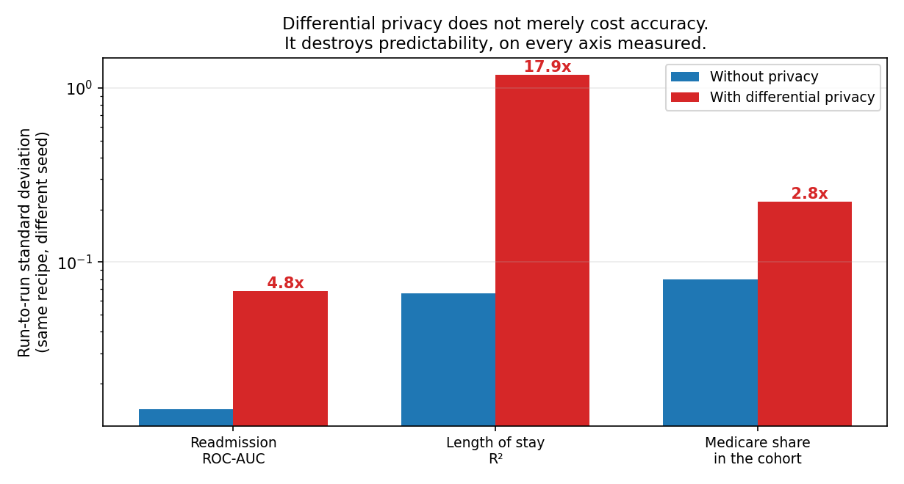
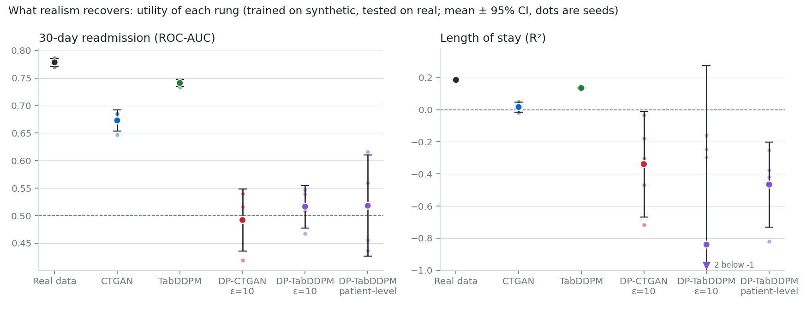

# SynthEHR

**Synthetic health data that is realistic, private and auditable, and the research
that measured how far each of those can go.**

[](https://github.com/BelhassenOuerghi/synthehr/actions/workflows/ci.yml)


SynthEHR is a Python toolkit for generating synthetic tabular health records and for
proving what a synthetic release is worth before anyone uses it. It trains a generator
(including diffusion models with patient-level differential privacy), measures the
release against real data on utility, realism, privacy and fairness, and produces a
release decision with the evidence a reviewer needs.

It is also the outcome of an independent research programme of mine on MIMIC-IV. I
added one safeguard at a time to a synthetic-data generator, measured what each one
cost, hardened every result over five seeds, and then tried to win the lost value
back. The tool's defaults, warnings and release rules come from what that research
found, including the parts that went against me.

It is free and open source under the MIT licence. Use it for anything; please credit
**Belhassen Ouerghi** (see [How to credit](#how-to-credit)).

---

**Contents:** [In one minute](#in-one-minute) ·
[Why](#why-this-exists) ·
[The research, pillar by pillar](#the-research-pillar-by-pillar) ·
[The tool](#the-tool) ·
[Repository map](#repository-map) ·
[Engineering notes](#engineering-notes) ·
[How to credit](#how-to-credit)

---

## In one minute

```bash
git clone https://github.com/BelhassenOuerghi/synthehr && cd synthehr
pip install -e .                    # Python 3.9+, PyTorch, scikit-learn, XGBoost
synthehr demo --quick               # fabricated cohort, end to end, about a minute
```

```python
from synthehr import DPTabDDPM, ReleaseGate, evaluate

gen = DPTabDDPM(epsilon=10, privacy_unit="patient")          # formal privacy, per patient
gen.fit(train, discrete_columns=["sex", "insurance", "readmitted"],
        groups=train_patient_ids)
synthetic = gen.sample(len(train))

report = evaluate(train, test, synthetic, target="readmitted",
                  discrete_columns=["sex", "insurance", "readmitted"],
                  sensitive=["sex", "insurance"], generator=gen)
print(report.to_markdown())                                  # utility, realism, privacy, fairness
print(ReleaseGate(min_utility_ratio=0.5).check(report).to_markdown())
```

---

## Why this exists

Health records are valuable for research precisely because they are detailed, and
dangerous to share for the same reason. Synthetic data promises to separate the two:
release generated records, keep the patients private. That promise is conditional.
Synthetic data is only worth generating if a model trained on it still works on real
patients; only worth releasing if it does not leak the people it came from; and only
worth defending if it represents those patients fairly and its release can be
justified to a regulator.

Most tools optimise one of these at a time. I wanted to know what they cost **each
other**, so I built a ladder: start with a generator, add one safeguard per rung,
keep the evaluation harness frozen so that every change in the numbers is caused by
the safeguard just added, and measure everything on the same real prediction tasks.
Then build the tool that the measurements say should exist.

---

## The research, pillar by pillar

Everything below was measured on MIMIC-IV v3.1 (ICU stays), with patient-disjoint
splits and, from the evidence layer onwards, five seeds and 95% confidence intervals.
Each step links to its full write-up in [`research/`](research/README.md).

### Foundations: what can real data do?

Before generating anything, I replicated three published prediction models on
MIMIC-IV, so that every synthetic result has a real-data ceiling to be compared with.

* **Length of stay** ([Peres et al., 2022](research/foundations/length-of-stay/README.md)):
  a stacked random-forest ensemble. Reproduced the published patient-level R² (0.171
  against 0.17).
* **30-day readmission** ([Blinder, 2019](research/foundations/readmission/README.md)):
  gradient-boosted trees. ROC-AUC 0.778 against the published 0.82, with the gap
  explained (different database, label and cohort).
* **Bed demand** ([Lee et al., 2021](research/foundations/bed-demand/README.md)):
  count-series forecasting; the probabilistic result reproduced.

These cohorts are the real data every later stage synthesises. **Ceilings used from
here on:** readmission ROC-AUC 0.778, length-of-stay R² 0.186, bed-demand MAE 1.475.

### Stage 0: how much signal survives synthesis?

**Why first:** every safeguard can only cost utility, so the cost of synthesis itself
is the baseline. **What I built:** CTGAN (Xu et al., 2019) from scratch, MIT-licensed,
so that later stages could modify its internals. **What I found:** synthesis alone is
expensive. Readmission ROC-AUC falls from 0.778 to 0.690 and length-of-stay R² from
0.186 to 0.009, essentially all of its signal. The count series survives intact.
[Stage 0 →](research/stage0-synthesis/README.md)

### Stage 1: what does a formal privacy guarantee cost?

**Why second:** without privacy nothing may be released, so the other pillars are
moot; and privacy is the most constraining safeguard, so later stages must be measured
under it. **What I built:** DP-SGD on the CTGAN critic (the generator inherits the
guarantee), a Rényi accountant written from scratch, privacy accounting for the
category counts CTGAN otherwise leaks for free, and membership-inference attacks.
**What I found:** at ε = 10, readmission falls further to 0.519. More important, and
only visible with several seeds: privacy makes the generator **unpredictable**.
Run-to-run spread grows 4.8-fold on readmission and 17.9-fold on length of stay, so a
single private run cannot tell a data controller whether the release is usable. And the
attacks sit at chance **even without privacy**, so an attack at chance certifies
nothing: only the formal bound can. [Stage 1 →](research/stage1-privacy/README.md)

### Stage 2: can subgroups be represented fairly, for free?

**Why third:** fairness is only well-posed at a fixed privacy budget, and privacy is
what disturbs it. **What I built:** fair conditional sampling, which reweights the
private generator's conditioning at **zero additional ε** (post-processing), and a fair
training variant. **What I found:** privacy does not bias representation in a fixed
direction; it makes it unstable. Across five seeds the share of Medicare patients in
the private release ranged from 0.095 to 0.618 against a real 0.542. Fair sampling's
utility cost is below the noise floor. And when the classifier predicts no positives,
parity metrics report perfect fairness: they must always be read with utility.
[Stage 2 →](research/stage2-fairness/README.md)

### Stage 3: can release evidence be generated rather than written?

**Why fourth:** compliance evidence consumes the privacy and fairness results; written
earlier it would be empty. **What I built:** an evidence compiler that writes the DPIA,
data card, model card, risk register and regulatory mapping from the pipeline's own
numbers and fails if a value is missing, so documents cannot drift from the data; and
a release gate with negative controls proving it can refuse. Human sign-offs are held
open by design: code never closes them. **What I found:** a release can be perfectly
compliant and scientifically useless (readmission ROC-AUC 0.484), and a framework that
reported only privacy and fairness would have certified it. [Stage 3 →](research/stage3-compliance/README.md)

### Evidence layer: which of those findings are real?

**Why here:** every number above was first measured once. **What I built:** a five-seed
re-run on patient-disjoint splits (fixing a leak that had put 43% of readmission test
rows in the same patients as training rows), paired tests, and a negative control that
measures the noise floor of private generators. **What I found:** the minimum effect
five seeds can detect is 0.151 ROC-AUC and 3.08 R². Two of the earlier stages' claims,
including Stage 2's original headline, were single lucky runs, and I **retracted
them** in place. The central result became: reporting a single private training run as
"the cost of privacy", common practice, is unsound. [Evidence →](research/evidence/README.md)



### Stage 4: can realism be recovered inside the safeguards?

**Why last:** realism is optimised inside the region the safeguards define; starting
from the strongest generator would have left nothing to recover. **What I built:** a
diffusion model, TabDDPM (Kotelnikov et al., 2023), from scratch, with a private
trainer that uses true Poisson sampling, per-example gradients and, for the first time
in the programme, **the patient as the privacy unit**. Realism was measured directly,
against real rows no generator saw. The design, hypotheses and decision rules were
[pre-registered](research/stage4-realism/doc/PREREGISTRATION.md) before the 300-run
main experiment. **What I found:**

1. **Without privacy, realism is recoverable.** TabDDPM beats CTGAN on both tasks
   (readmission ROC-AUC 0.741 against 0.673; length-of-stay R² 0.135 against 0.017;
   both survive multiple-testing correction), and its largest version closes 74% and
   82% of the gap to real data.
2. **At ε = 10 it does not survive.** Private TabDDPM is no better than private CTGAN;
   both are at chance on readmission. A diagnostic run showed the privacy noise, not
   the trainer, is responsible.
3. **Realism and privacy do not commute.** The model size that is best without privacy
   is the worst with it. A generator tuned for realism and then made private lands in
   the wrong place, which is why privacy comes first on the ladder.
4. **Pooling buys predictability with privacy.** Four pooled private generators cut
   the run-to-run spread tenfold, but at a composed ε of about 23; split ε = 10 four
   ways and the pool is worse than one generator.
5. **Protecting the patient instead of the ICU stay costs nothing measurable.**

[Stage 4 →](research/stage4-realism/README.md)



### The whole ladder in one table

| Rung | Release | ε | Readmission ROC-AUC | Length-of-stay R² | Realism (detection AUC, 0.5 = indistinguishable) | Membership attack | Release gate |
|---|---|---|---|---|---|---|---|
| ceiling | real data | – | 0.778 | 0.186 | 0.52 (real vs real) | – | – |
| 0 | CTGAN | ∞ | 0.69 | 0.01 | 1.00 | chance | refused: no formal guarantee |
| 1 | DP-CTGAN | 10 | 0.52 | −0.67 | 1.00 | chance | promoted |
| 2 | DP-CTGAN, fair sampling | 10 | 0.48 | −0.73 | – | chance | promoted |
| 4 | TabDDPM, large | ∞ | 0.75 | 0.155 | 0.77 | chance | refused: no formal guarantee |
| 4 | DP-TabDDPM, small | 10 | 0.54 | 0.03 | 1.00 | chance | promoted |

Read down the columns and the programme's argument is visible. Every release, private
or not, passes the attacks. The gate's decision therefore rests on ε alone: it
promotes the releases with little utility and refuses the realistic ones. That is why
the tool's gate adds a utility floor (below), and why its documentation tells you what
an attack at chance does and does not mean.

---

## The tool

### What it does

| Step | Python | Command line |
|---|---|---|
| Generate | `TabDDPM`, `DPTabDDPM`, `CTGAN`, `DPCTGAN`, `PoissonAR`, `pool` | `synthehr fit`, `synthehr sample` |
| Measure | `evaluate` → `Report` | `synthehr evaluate` |
| Decide | `ReleaseGate`, `build_evidence_pack` | `synthehr gate` |

### Install

```bash
git clone https://github.com/BelhassenOuerghi/synthehr && cd synthehr
pip install -e .
# CPU-only machines can save space with:
#   pip install torch --index-url https://download.pytorch.org/whl/cpu
```

The diffusion models use a GPU when one is available (`device="auto"`: CUDA, then
Apple MPS, then CPU).

### Command line

```bash
# 1. train (here: patient-level differential privacy at epsilon 10)
synthehr fit --data train.csv --out model.synthehr --model dp-tabddpm \
    --discrete sex,insurance,admission_type,readmitted \
    --group-column patient_id --privacy-unit patient --epsilon 10

# 2. generate
synthehr sample --model model.synthehr --rows 50000 --out synthetic.csv

# 3. measure against real rows the generator never saw
synthehr evaluate --train train.csv --test test.csv --synthetic synthetic.csv \
    --target readmitted --discrete sex,insurance,admission_type,readmitted \
    --sensitive sex,insurance --drop patient_id --model model.synthehr --out report/

# 4. decide, and write the evidence pack
synthehr gate --report report/report.json --min-utility-ratio 0.5 --evidence evidence/
```

`synthehr gate` exits with status 0 when the release is promoted and 2 when it is
refused, so it can stop a pipeline.

### Python

```python
from synthehr import (TabDDPM, DPTabDDPM, DPCTGAN, evaluate, ReleaseGate,
                      build_evidence_pack, pool)
from synthehr.data import patient_disjoint_split, impute_with_train_medians

train, test = patient_disjoint_split(df, groups=df["patient_id"])
patients = train.pop("patient_id"); test = test.drop(columns="patient_id")
train, test = impute_with_train_medians(train, test, discrete=CATEGORICAL)

gen = TabDDPM().fit(train, discrete_columns=CATEGORICAL)        # most realistic
gen.save("model.synthehr")

private = DPTabDDPM(epsilon=10, privacy_unit="patient").fit(
    train, discrete_columns=CATEGORICAL, groups=patients)
print(private.epsilon_, private.epsilon_add_remove_)

fair = DPCTGAN(epsilon=10).fit(train, CATEGORICAL).sample_balanced(
    len(train), sensitive_columns=["sex", "insurance"])      # zero extra epsilon

released, eps = pool([private, other_private_model], n=len(train))  # composed budget

report = evaluate(train, test, private.sample(len(train)), target="readmitted",
                  discrete_columns=CATEGORICAL, sensitive=["sex", "insurance"],
                  generator=private)
decision = ReleaseGate(min_utility_ratio=0.5).check(report)
build_evidence_pack(report, decision, "evidence/", name="ICU cohort, release 1")
```

A complete script is in [`examples/quickstart.py`](examples/quickstart.py).

### Choosing a generator

| You need | Use | Why (from the research) |
|---|---|---|
| The most realistic data, no formal privacy (internal use, method development) | `TabDDPM(size="large")` | Closed 74 to 82% of the gap to real data; CTGAN closed far less |
| A formal privacy guarantee | `DPTabDDPM(size="small")` | Under DP the smallest model was best; larger ones collapsed |
| A guarantee per **patient**, not per record | `privacy_unit="patient"` + `groups=` | Cost nothing measurable in the research |
| Balanced subgroups at no extra privacy cost | `DPCTGAN.sample_balanced` or `synthehr.fairness.fair_resample` | Post-processing of a private generator |
| More predictable private releases | `pool([...])` | Spread falls about tenfold, but ε composes (four runs at 10 cost about 23) |
| A daily count series (admissions, occupancy) | `PoissonAR(epsilon=...)` | Tabular generators destroy autocorrelation; this one forecasts as well as the real series |

### What the privacy guarantee covers, and what it does not

* **ε is a bound on what any attacker can learn**, whatever they know. Membership
  attacks at chance are not a substitute: in the research they sat at chance against
  non-private generators too. The gate therefore refuses any release without a formal
  guarantee.
* **The unit matters.** `privacy_unit="record"` protects one row; a patient with ten
  ICU stays has ten rows. Use `"patient"` when patients repeat.
* **Noise convention.** ε is reported as in the research (noise calibrated to
  replace-one sensitivity). `epsilon_add_remove_` gives the same run under the more
  common add/remove definition; it is smaller (about 4.4 for ε = 10).
* **Not covered:** the preprocessing (category lists, numeric quantiles or mixture
  components) is fitted on the real data and **stored in saved model files**. Share
  synthetic data, not model files, when the data are sensitive. Trained models never
  keep the training rows themselves.
* **Hyperparameter tuning on private data** leaks a little that ε does not count.
  The defaults were chosen once, in the research pilot.

### Reading a report

`evaluate` compares the synthetic data with real held-out rows and always shows the
real data's own result beside it: the **ceiling** for utility (train on real, test on
real) and the **control** for realism (real training rows against real held-out rows,
which is rarely exactly 0.5). Report the synthetic number next to its control, never
alone. Three lessons from the research are built in: missing values are filled with
**training** medians in every frame (filling each split with its own median let a
classifier tell real training from real test rows); **coverage** is reported because
precision and recall reward over-dispersed private samples; and the **label rate** is
reported because a release with the wrong share of positives produces a classifier
that predicts one class, which makes parity-based fairness metrics meaningless (the
report flags such degenerate classifiers).

### The release gate and the evidence pack

`ReleaseGate` decides internal promotion from technical checks: a formal guarantee
within the ceiling, attacks at chance (including at 1% false positives), few
near-copies, non-degenerate fairness evidence and, if you set `min_utility_ratio`,
enough utility to be worth releasing. External release stays on **HOLD** until a
person records the data-use and governance sign-offs. `build_evidence_pack` writes a
data card, the decision and every value as JSON, all compiled from the report. They are
evidence for a reviewer, not legal advice.

### Performance

Measured on an Apple M2 Max with 30,000 training rows: non-private TabDDPM (20,000
steps) trains in about 2 to 6 minutes on the GPU; private TabDDPM at the research
settings (200 epochs, expected batch 2,048) in about 8 to 14 minutes; CTGAN in 20 to
35 minutes on the CPU. Sampling 80,000 rows takes under a minute. On a CPU the
diffusion models are roughly three times slower.

---

## Repository map

```
synthehr/
├── src/synthehr/            the tool
│   ├── generators/          CTGAN, DP-CTGAN, TabDDPM, DP-TabDDPM, PoissonAR
│   ├── privacy/             Rényi accountant, membership-inference attacks
│   ├── fairness/            subgroup metrics, fair resampling
│   ├── evaluation/          utility, realism, the Report
│   ├── compliance/          release gate, evidence pack
│   ├── data.py              patient-disjoint split, train-median imputation
│   ├── ensemble.py          pooled releases with composed budgets
│   ├── demo.py              a fabricated cohort for trying things out
│   └── cli.py               the synthehr command
├── tests/                   fabricated data only; includes bit-equivalence with research/
├── examples/quickstart.py
└── research/                the evidence behind every default
    ├── foundations/         three replication studies (real-data ceilings)
    ├── stage0-synthesis/    CTGAN
    ├── stage1-privacy/      DP-CTGAN, accountant, attacks
    ├── stage2-fairness/     fair sampling and training
    ├── stage3-compliance/   evidence compiler and release gate
    ├── evidence/            five seeds, noise floor, retractions
    ├── stage4-realism/      TabDDPM, patient-level DP, pre-registered
    └── common/              the frozen shared modules (hash-checked)
```

---

## Engineering notes

* **The tool is the research code.** Every generator, the accountant, the attacks and
  the realism metrics are tested to reproduce the frozen research implementations bit
  for bit for a fixed seed ([`tests/test_equivalence.py`](tests/test_equivalence.py)),
  so the published results vouch for the package. The research modules themselves are
  hash-checked in CI.
* **Tests use fabricated data only** and run in about half a minute on a CPU: exact
  per-example gradients against an explicit loop, per-patient clipping bounds,
  privacy accounting targets, gate decisions, evidence rendering, persistence, and that
  saved models carry no training rows (`python tests/run_tests.py` or `pytest`).
* **From scratch, permissive licences only.** No SDV, Opacus or third-party diffusion
  code: every mechanism a safeguard touches is explicit and editable.
* **Honest reporting is a design rule.** Pre-registration, noise floors, negative and
  positive controls, and retractions kept visible; the
  [research README](research/README.md#what-was-found-wrong-and-where-it-is-reported)
  lists every error the programme found in itself, including two found while
  packaging this tool.

---

## How to credit

SynthEHR is free to use, modify and distribute, including commercially, under the
[MIT licence](LICENSE). The only condition is the licence's own: keep the copyright
notice, which names the author. If SynthEHR helps your work, please credit it:

> Belhassen Ouerghi. *SynthEHR: synthetic tabular health data with measured realism,
> formal privacy and release evidence.* https://github.com/BelhassenOuerghi/synthehr

GitHub's "Cite this repository" button gives the same in BibTeX and APA
([`CITATION.cff`](CITATION.cff)).

## Data use

The research uses MIMIC-IV v3.1 under the PhysioNet Credentialed Health Data Use
Agreement. No real or synthetic patient-level data, and no model trained on it, is in
this repository: only aggregate results, with cells describing fewer than 10 patients
suppressed. Synthetic data derived from a credentialed dataset is still governed by
that dataset's agreement. SynthEHR is research software, not a medical device.
