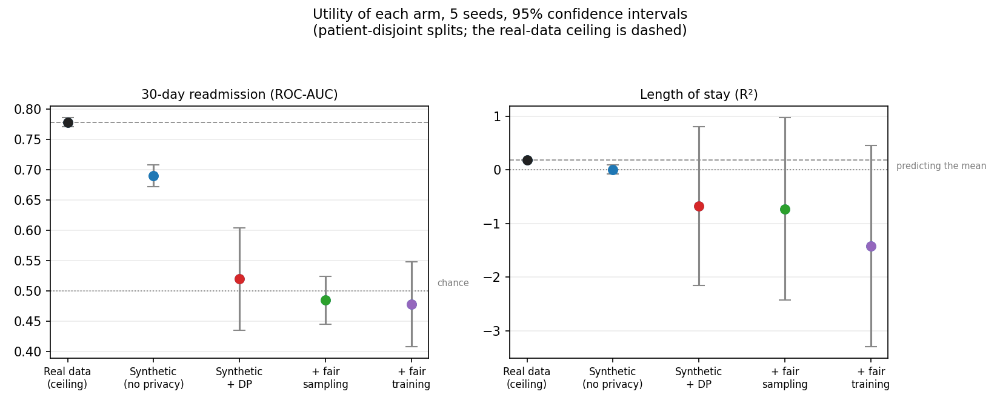
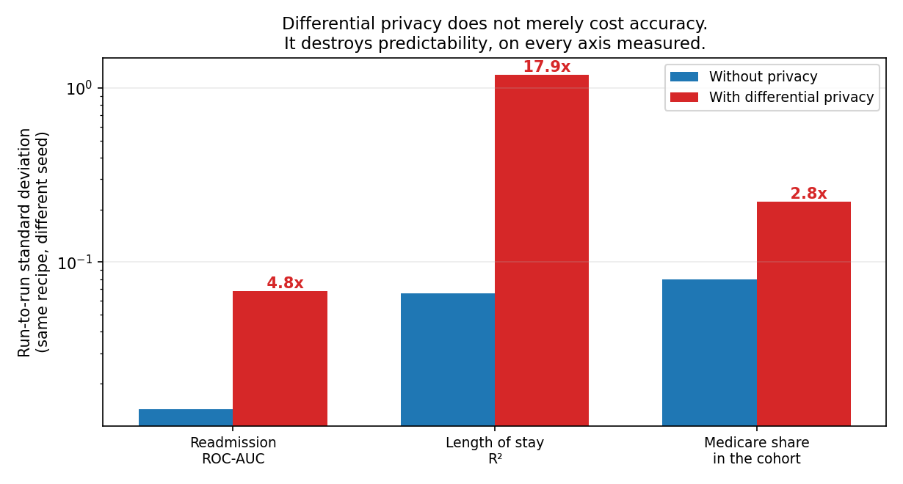
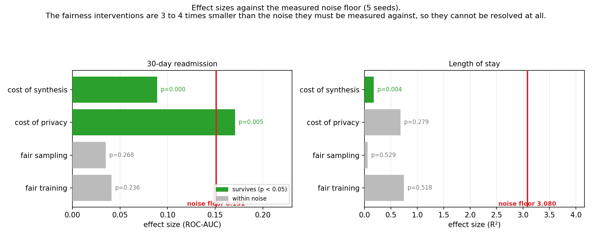

# Evidence hardening: multi-seed confidence intervals across the synthetic-EHR programme

*An EngD research study. Belhassen Ouerghi, University of Hertfordshire.*

*Programme: [Stage 0, CTGAN baseline](https://github.com/BelhassenOuerghi/mimic-synthetic-ctgan) · [Stage 1, privacy](https://github.com/BelhassenOuerghi/mimic-synthetic-dp-ctgan) · [Stage 2, fairness](https://github.com/BelhassenOuerghi/mimic-synthetic-fair-dp-ctgan) · [Stage 3, compliance](https://github.com/BelhassenOuerghi/mimic-synthetic-ethic-fair-dp-ctgan) · [Stage 4, realism](https://github.com/BelhassenOuerghi/mimic-synthetic-realism) · [Evidence: five seeds, noise floor](https://github.com/BelhassenOuerghi/mimic-synthetic-evidence)*

## 1. Overview

This repository is the evidence-hardening layer of my four-pillar synthetic-EHR
programme ([Stage 0](https://github.com/BelhassenOuerghi/mimic-synthetic-ctgan),
[Stage 1](https://github.com/BelhassenOuerghi/mimic-synthetic-dp-ctgan),
[Stage 2](https://github.com/BelhassenOuerghi/mimic-synthetic-fair-dp-ctgan),
[Stage 3](https://github.com/BelhassenOuerghi/mimic-synthetic-ethic-fair-dp-ctgan),
[Stage 4](https://github.com/BelhassenOuerghi/mimic-synthetic-realism)).
It exists to answer the question every examiner asks and no single-seed study can:
which of these findings are real, and which are run-to-run noise?

It does two things the stage repositories could not do for themselves. It corrects a
data-leakage defect found in the readmission split and re-runs every stage on
patient-disjoint splits. And it replaces every headline single-seed number with a mean
and a 95% confidence interval over five seeds, applying a paired significance test
across seeds to each of the programme's central claims, and reporting honestly which
survive and which do not.

Two of the programme's published claims did not survive, including one stage's headline
finding. They were retracted, and a stronger result replaced them.

## 2. Why this is necessary

**The leakage.** The readmission cohort holds 87,041 ICU stays from only 60,537
patients: roughly a quarter of patients have more than one stay, accounting for almost
half the rows. The original split was row-level and stratified, which put 6,046 patients
on both sides of it, so that about 43% of the test set consisted of patients the model
had already seen. The length-of-stay split was already patient-level and clean.

The effect of this defect is asymmetric, which is why it matters more than it first
appears. On utility it is small: the ceiling was inflated by about 0.011 in ROC-AUC,
which is less than the run-to-run noise, so the utility findings survive. On privacy it
is fatal: membership inference uses training rows as members and test rows as
non-members, and roughly 43% of those non-members were patients whose other stays were
in training. The control group was conceptually broken. That is a validity problem
rather than a magnitude problem, and it cannot be excused by the small effect size. It
is also the same conceptual error as the row-level privacy adjacency recorded in the
risk register: one mistake wearing two hats.

**The noise.** Stage 2 produced, by accident, a measurement of run-to-run variation, and
it was large. Several single-seed differences reported in Stages 1 and 2 were smaller
than that variation, which means they were not findings at all. Confidence intervals are
therefore not a polish step but a precondition for any claim about the frontier.

## 3. Method

Per seed, on patient-disjoint splits, and using the frozen harness (identical
architecture, downstream models and real test sets as Stages 0 to 2), six arms are
produced for each tabular task.

| Arm | What it is |
|---|---|
| `TRTR` | the real-data ceiling, recomputed per seed because the split moves |
| `stage0` | non-private CTGAN |
| `stage1` | DP-CTGAN at the release budget |
| `dpbaseline` | DP-CTGAN, fresh run, retained as a determinism check |
| `fairsample` | DP with fair conditional sampling, at no additional budget |
| `fairtrain` | DP with fair training-by-sampling |

Membership-inference attacks are run with patient-disjoint members and non-members,
alongside subgroup fairness, representation audits, and the bed-demand task.

A separate negative control (`src/noise_control.py`) refits the DP generator with an
identical recipe and an identical train/test split, re-seeding the whole generator
pipeline (model seed = data seed + 1000). That changes the model's random initialisation
and also the 30,000-row subsample the generator is fitted on, which the harness draws
with the same seed. The spread between that replicate and the original is therefore the
noise of re-running the pipeline, not of initialisation alone, and it is the quantity any
between-arm difference must exceed in order to be a finding. (An earlier version of this
paragraph described it as initialisation noise only; Pillar 4's replicates, which hold
the fitting rows fixed, separate the two.)

The decisive output is not the table of means but the significance table: a paired test
across seeds for each central claim, with the negative control as a built-in check that
should show nothing. Anything that fails is reported as within noise, which for several
previously stated results is the more honest verdict.

## 4. Reproducibility

```bash
PY=python3   # any Python with requirements.txt installed

make run       PY=$PY   # five-seed re-run; resumable, each seed checkpoints
make noise     PY=$PY   # negative control: independent DP replicates
make aggregate PY=$PY   # means, confidence intervals and paired tests
```

The run is resumable by design: each seed writes its results on completion and is
skipped if present, so a crash late in the run costs one seed rather than the whole
thing. All settings live in [`config.yaml`](config.yaml), and the source files are
vendored unchanged from the stage repositories, so that the only differences from the
published stage results are the corrected split and the seed.

## 5. Results

Full tables are in [`results/results_table.md`](results/results_table.md), with raw
per-seed values in `results/seeds/`.

### Figures

**Utility of each arm, with 95% confidence intervals.** The cost of synthesis and the
cost of privacy are both visible, and so is the width of the error bars on the
differentially private arms.



**Differential privacy destroys predictability.** Run-to-run standard deviation, with
and without privacy, on three independent measurements. Note the log scale.



**The measured noise floor against the effects the programme claimed.** Green survives
a paired test across seeds; grey does not. The fairness interventions are three to four
times smaller than the noise they must be measured against, and therefore cannot be
resolved at all. This is the figure that killed two of this programme's own findings.



### 5.1 The noise floor, which governs everything else

Re-running the identical DP recipe on the identical split, re-seeding only the generator
pipeline (its initialisation and its 30,000-row fitting subsample), produces the
following.

| Task | Mean absolute difference between replicates | Maximum | Minimum detectable effect at five seeds |
|---|---|---|---|
| Readmission (ROC-AUC) | 0.095 | 0.157 | 0.151 |
| Length of stay (R²) | 1.083 | 3.756 | 3.08 |

The fairness interventions of Stage 2 produce effects of 0.035 to 0.041 in ROC-AUC. They
are three to four times smaller than the noise against which they must be measured, and
resolving them would take roughly 50 seeds on readmission and thousands on length of
stay.

This is the programme's central methodological result. It is not a limitation of this
study but a property of DP generative modelling at this budget, and it means that the
common practice of reporting a single DP training run as the cost of privacy is unsound.
Two of this programme's own published claims were casualties of exactly that error.

### 5.2 Differential privacy destroys predictability, on every axis measured

| Quantity | Non-private (sd) | DP at the release budget (sd) | Inflation |
|---|---|---|---|
| Readmission ROC-AUC | 0.014 | 0.068 | 4.8x |
| Length of stay R² | 0.066 | 1.193 | 17.9x |
| Medicare share in the synthetic cohort | 0.080 | 0.223 | 2.8x |

Individual runs at the same budget produced length-of-stay R² values from -0.041 to
-2.799, and Medicare shares from 0.095 to 0.618 against a real share of 0.542. A data
controller who runs the generator once cannot know whether the cohort they are about to
release under-represents its sickest subgroup sixfold or reproduces it faithfully, and
auditing that single run cannot tell them. An unpredictable harm is worse than a
systematic one, because a systematic one can be corrected.

### 5.3 What survived, and what did not

| Claim | Origin | Verdict |
|---|---|---|
| The cost of synthesis is real | Stage 0 | Significant on both tasks (p = 0.0002 and p = 0.004) |
| The cost of privacy is real on readmission | Stage 1 | Significant (p = 0.005) |
| Attacks sit at chance even without privacy, so only the formal bound can certify a release | Stage 1 | Survives, now with a valid patient-disjoint control group |
| Fair sampling costs no additional privacy budget | Stage 2 | Holds; it is a theoretical claim from post-processing |
| Doubling the training budget lifted length-of-stay R² to 0.054 | Stage 0 | Retracted: 0.054 was the most favourable of five seeds; the mean is 0.009 ± 0.083 |
| Differential privacy collapses subgroup representation | Stage 2 headline | Retracted: one seed. Across seeds the share is 0.406 (sd 0.223), ranging from 0.095 to 0.618 |
| Fair sampling repairs representation at no utility cost | Stage 2 | Downgraded: it rebalances rather than restores, and it stabilises; the utility effect is undetectable rather than absent |
| Fair training is markedly worse | Stage 2 | Retracted: it rested on one run; the difference is within noise (p = 0.52) |
| The mean utility cost of privacy on length of stay | Stage 1 | Not resolvable at five seeds (p = 0.28), because the variance is enormous |

### 5.4 The negative control

The control is correctly null (p = 0.17 on readmission, p = 0.53 on length of stay),
which validates the paired tests above. Its magnitude, however, is the point of Section
5.1: the control's own difference exceeds every fairness effect the programme claimed to
measure.

A note on method. The originally intended control, comparing two arms that shared a class
and a seed, turned out to be bit-identical. That is a useful determinism and
reproducibility check, but it is not a noise control, because it compares a model to
itself. It was rebuilt as `src/noise_control.py`. A control that cannot fail is worth
nothing, which is the same lesson this programme learned when it built a release gate
that could refuse.

## 6. Limitations

* **Five seeds is a small sample.** The intervals are honest but wide, and a difference
  reported as within noise may be real but underpowered. This is stated rather than
  glossed over.
* **The exploratory budget grid remains single-seed.** It establishes the shape of the
  privacy-utility frontier rather than a headline number, and is treated accordingly.
* **Patient-level privacy adjacency is open for the CTGAN stages.** The splits are now
  patient-disjoint, but the Stage 1-2 guarantee remains per-stay. Pillar 4
  ([`mimic-synthetic-realism`](https://github.com/BelhassenOuerghi/mimic-synthetic-realism))
  implements per-patient Poisson sampling and clipping for its diffusion generator and
  measures what the patient-level guarantee costs.
* **One dataset.** Generalisation is the job of the planned second-dataset validation.
* **Known issue, found in Pillar 4: each split is imputed with its own median.**
  `clean_numeric` fills missing values in the training and test splits separately. On
  readmission, `albumin_min` is 72% missing, and in seeds 43 and 46 the two medians
  differ (3.2 against 3.1), which makes real training and test rows distinguishable by
  that one constant. Every arm is scored on the same test split, so the between-arm
  comparisons here remain paired and like for like, and the membership attacks are
  unaffected in practice (they sit at chance in those seeds too); the harness is kept
  frozen for comparability. Pillar 4 measures realism against a test split imputed with
  the training medians.
* **Bit-for-bit reproduction needs the same thread count.** Re-running a seed with a
  different number of CPU threads changes floating-point summation order, and GAN
  training amplifies that into a different run. Pillar 4 re-ran the Stage 0 and Stage 1
  recipes with the same seeds on two threads and got different (statistically
  consistent) values; a seed alone is not a reproducibility guarantee.

## 7. Data use and ethics

PhysioNet Credentialed Health Data Use Agreement, MIMIC-IV v3.1. No real or synthetic
patient-level data is committed, and datasets are written outside the repository.
Research artefacts, not medical devices.

---

Data: Johnson, A., et al. *MIMIC-IV* v3.1, PhysioNet (2024).
