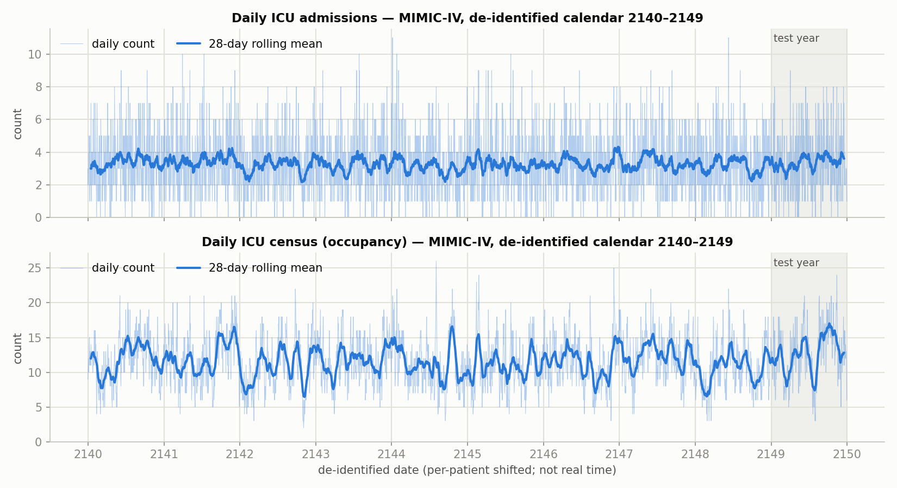
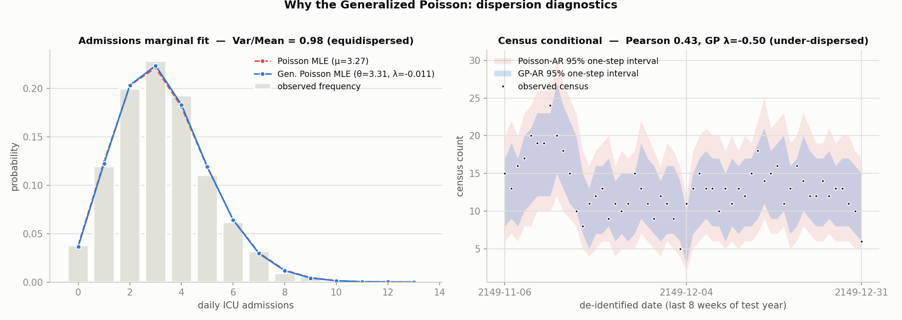
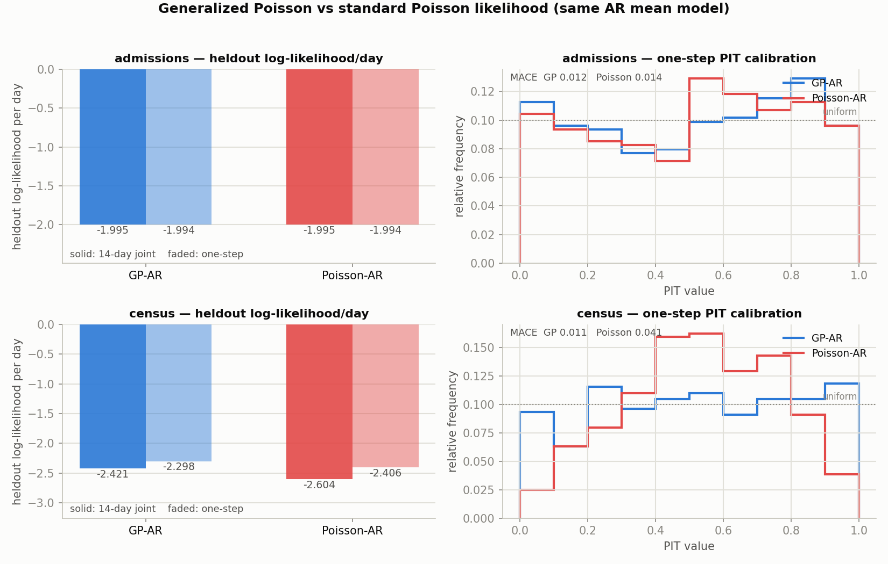
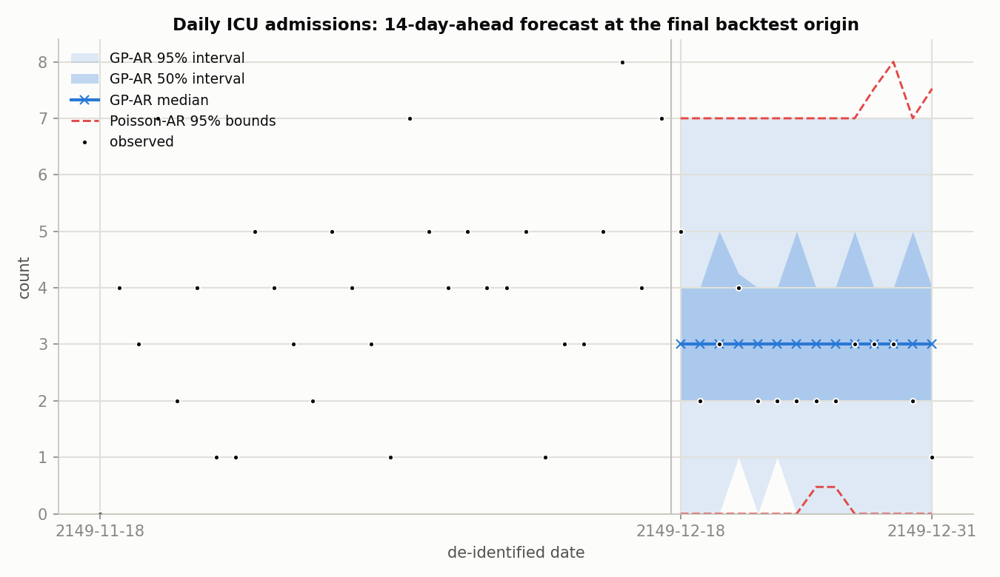
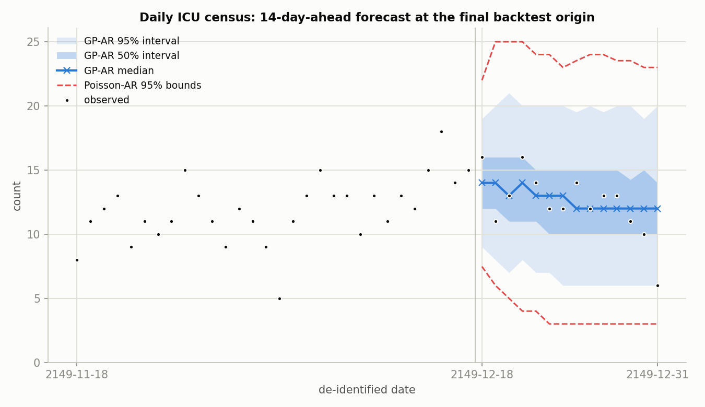

# Forecasting daily ICU bed demand: a replication of Lee et al. (2021) on MIMIC-IV

*A replication study in [SynthEHR](../../../README.md), an independent research programme by Belhassen Ouerghi.*

This repository contains my replication of the single-hospital count-forecasting
experiment of Lee, Lymperopoulos, Cohen, Wong and Hughes (2021), adapted to the
MIMIC-IV v3.1 critical-care database. I re-implement their central methodological
proposal, which is probabilistic forecasting of a hospital's daily counts with a
Generalized Poisson likelihood over an autoregressive latent mean, in
pure numpy/scipy, derive analogous daily demand series from MIMIC-IV, run a
rolling 14-day-ahead backtest against a standard-Poisson twin and two naive
baselines, and reproduce the paper's signature probabilistic forecast plot. All
results in this README come from a real end-to-end run of the committed code.

> **Upstream:** A. H. Lee, P. Lymperopoulos, J. T. Cohen, J. B. Wong,
> M. C. Hughes. *Forecasting COVID-19 counts at a single hospital: A Hierarchical
> Bayesian approach.* ICLR 2021 Workshop on Machine Learning for Preventing and
> Combating Pandemics. [arXiv:2104.09327](https://arxiv.org/abs/2104.09327).
> Code: [tufts-ml/single-hospital-count-forecasting](https://github.com/tufts-ml/single-hospital-count-forecasting).

---

## 1. The capacity-planning problem

A hospital administrator planning staffing and bed allocation needs an answer to
a deceptively simple question: *how many patients will need a bed on each of the
next fourteen days?* Point forecasts are of limited use for this decision: what
matters is a calibrated predictive distribution, because the cost of running
out of ICU capacity is asymmetric to the cost of over-provisioning. Lee et al.
frame exactly this problem for a single hospital site with only a short history
of its own daily counts, and argue that the model must (i) respect the *count*
nature of the data and (ii) capture its *dispersion* correctly, since the width
of the prediction interval is the decision-relevant output.

## 2. The upstream method

Lee et al. model a latent log-rate that evolves as an autoregression (their GAR
model; a Gaussian-process variant, GGP, is offered as an alternative latent
process), with counts emitted through a **Generalized Poisson** likelihood:

```
f_t   = β₀ + Σ_{w=1..W} β_w · f_{t−w} + ε_t,     ε_t ~ Normal(0, τ²)
y_t   ~ GenPoisson(θ_t = exp(f_t), λ)
```

Inference is by MCMC (NUTS) in PyMC3; forecasts are 5000 posterior-predictive
sample paths, summarized as the 2.5/50/97.5 percentiles; models are scored by
heldout log-likelihood per day over a 14-day window. Their central empirical
claim (their Experiment #1, `poisson_vs_genpoisson.py`) is that the Generalized
Poisson likelihood outperforms the standard Poisson **because real hospital count
series are not equidispersed**, and Poisson's variance-equals-mean straitjacket
misstates forecast uncertainty even when the mean model is identical.

### The Generalized Poisson likelihood

The GP distribution (Consul & Jain, 1973) has pmf

```
P(y | θ, λ) = θ (θ + λy)^{y−1} e^{−(θ+λy)} / y!,   y = 0, 1, 2, …
```

with θ > 0 and −1 ≤ λ < 1. Its first two moments are E[y] = θ/(1−λ) and
Var[y] = θ/(1−λ)³, so the **dispersion index is Var/Mean = (1−λ)⁻²**:

- λ > 0 gives over-dispersion (variance exceeds the mean),
- λ = 0 gives exactly the standard Poisson,
- λ < 0 gives under-dispersion (variance below the mean).

That last regime matters here: a Poisson model cannot represent a count series
whose conditional variance is *smaller* than its conditional mean, and, as shown
below, the MIMIC-IV ICU census is precisely such a series. For λ < 0 the pmf is
truncated at m = ⌊−θ/λ⌋; the upstream code silently ignores the (tiny) leftover
mass, whereas my implementation renormalizes the truncated pmf numerically so
that all likelihood comparisons remain proper.

## 3. The adaptation: from Massachusetts DOT census counts to MIMIC-IV

**This is the key deviation from the upstream study, and I want to be explicit
about it.** The upstream experiments do **not** use MIMIC. They use aggregate
COVID-19 census counts published by the Massachusetts Department of Public
Health (CSV files bundled in their repository under `datasets/mass_dot_gov/`,
e.g. ~10 weeks of daily counts of hospitalized COVID patients at Tufts Medical
Center in summer 2020). My task was to derive an *analogous* daily count series
from MIMIC-IV and subject it to the same forecasting method.

From `icu/icustays.csv.gz` (94,458 ICU stays; the file's only columns used are
`intime`/`outtime` timestamps) I build two aggregate daily demand signals with
DuckDB:

1. **Daily ICU admissions**: the number of `icustays` rows grouped by
   `date(intime)`. This is the canonical "how many new beds will be demanded
   tomorrow" quantity, and the primary target of this replication.
2. **Daily ICU census (occupancy)**: the number of stays with
   `date(intime) ≤ d < date(outtime)`. This is the closer structural analogue of
   the upstream target, which was itself a hospital *census* count (patients in
   house), not an admissions count.

### The de-identified-dates caveat (read this before believing any plot)

MIMIC-IV shifts every patient's dates independently into the future (years
2110 to 2214), so **absolute dates are meaningless and cross-patient temporal
structure is destroyed**. The aggregate admission series is therefore *not* a
real epidemic curve or a real hospital's workload trace: independently shifting
each patient's timeline superposes ~65k independent point processes, which by
construction drives the daily admission count towards a homogeneous Poisson
process. I verified this empirically: the admission series has no day-of-week
effect and no autocorrelation (lag-1 ≈ 0.01), unlike any real hospital's
workload. I treat the series purely as **count data for methodological
replication**, exactly as the task of validating a forecasting pipeline
requires, and I draw no clinical conclusions from it. Interestingly, the
*census* series retains genuine short-range dynamics (lag-1 autocorrelation
≈ 0.75) because length-of-stay is preserved *within* each shifted patient. The
census behaves like an M/G/∞ queue driven by Poisson arrivals, which is exactly
the regime where its conditional distribution becomes under-dispersed.

### The analysis window

The per-patient shifting spreads stays over a ~105-year fake calendar with thin
edges (≈2 admissions/day in 2110, dropping below 1/day after 2200) and a dense,
stable plateau between ~2130 and ~2189 (about 3.2 to 3.5 admissions/day). I chose ten
contiguous years well inside the plateau, **2140-01-01 to 2149-12-31 (N = 3,653
days)**, so that the series is dense (only ≈3.8% zero-admission days), the rate
is stationary by construction, and there is ample history for an expanding-window
backtest. The final 52 weeks are held out for testing and the 52 weeks before
those for model selection; nothing after the forecast origin is ever seen by a
model.

## 4. Modelling and estimation (what I could and could not keep)

PyMC3 is effectively uninstallable in my environment (Python 3.9/macOS-arm64,
Theano backend), so following the pre-agreed fallback ("route B") I
re-implemented the model with numpy/scipy **maximum likelihood** instead of
MCMC. Two honest deviations from upstream follow from that choice:

1. **Observation-driven instead of parameter-driven autoregression.** The
   upstream latent AR log-rate makes the likelihood an integral over the latent
   path, which is what MCMC was doing for them. I use the observation-driven
   (INGARCH-style, cf. Famoye 1993's restricted GP regression) counterpart with
   a closed-form conditional likelihood:

   ```
   f_t = β₀ + Σ_{w=1..W} β_w · log(1 + y_{t−w})
   μ_t = exp(f_t)                        (conditional mean)
   y_t | past ~ GenPoisson(θ_t = (1−λ)·μ_t,  λ)
   ```

   Parameterizing θ_t = (1−λ)μ_t makes exp(f_t) the conditional mean *exactly*,
   so λ is a pure dispersion parameter and the GP-vs-Poisson contest is a
   like-for-like comparison with identical mean structure, which is the
   comparison the upstream paper is actually about. The standard-Poisson
   baseline is the same model with λ pinned at 0.

2. **MLE + asymptotic uncertainty instead of a posterior.** Parameters are
   estimated with `scipy.optimize` (Nelder-Mead polished by BFGS; λ fitted
   unconstrained through a tanh transform). Forecast uncertainty comes from
   500 Monte-Carlo trajectories per origin, with parameters drawn from the
   asymptotic normal N(MLE, I⁻¹) (numerical Hessian) as a Laplace-style stand-in
   for upstream's posterior sampling, configurable via `param_uncertainty` in
   `config.yaml`.

Everything else mirrors upstream: F = 14-day-ahead forecasts, forecast summaries
as 2.5/50/97.5 percentiles of sampled trajectories, heldout log-likelihood per
day as the headline probabilistic score, and AR window size W selected by a
validation-set grid search (their `gar_grid_search`; my grid is W ∈ {1,2,3,5,7}).
I additionally report MAE (of the predictive median), RMSE (of the predictive
mean), 95%/50% interval coverage and width, and PIT-based calibration error
(MACE over 10 bins), and I evaluate on a rolling-origin backtest, with 26
origins tiling the test year at a 14-day stride and models refit on the expanding
history at each origin, rather than upstream's single train/test split.

Baselines beyond the Poisson-AR twin: **seasonal-naive** (repeat the value from
7 days ago) and a **7-day moving average**, both given honest predictive
distributions via bootstrap of their own historical h-step errors.

## 5. Replication results

Everything below is produced by `make all` (see §6) and written to
[`results/metrics.json`](results/metrics.json) and
[`results/results_table.md`](results/results_table.md).

### 5.1 The two series, and why dispersion is the story



| series | mean | variance | marginal Var/Mean | conditional (Pearson) dispersion | GP λ̂ |
|---|---|---|---|---|---|
| ICU admissions | 3.28 | 3.21 | **0.980** | 0.978 | -0.011 |
| ICU census | 11.59 | 12.42 | 1.071 | **0.430** | **-0.505** |

Two very different dispersion regimes emerge, and neither is the over-dispersion
of the upstream COVID data:

- The **admissions** series is *equidispersed* (Var/Mean ≈ 0.98), which is the
  expected signature of the de-identification superposition argument above. Here
  the Generalized Poisson should not (and, below, does not) beat the Poisson; the
  fitted λ̂ ≈ -0.011 correctly collapses the GP onto its Poisson special
  case. I regard this as a *successful negative control*, not a failure: a
  flexible likelihood that hallucinated dispersion where there is none would be
  worrying.
- The **census** series is strongly *conditionally under-dispersed* (Pearson
  dispersion ≈ 0.43 given the AR mean): tomorrow's census is
  yesterday's census plus a modest random in/outflow, so its conditional
  variance is far below its conditional mean of ≈11.6. This is the
  λ < 0 regime that the Generalized Poisson supports and the standard Poisson
  cannot represent at all. The fitted **λ̂ = -0.505** implies a conditional
  Var/Mean of (1−λ̂)⁻² ≈ 0.44, in close agreement with the empirical
  0.43. That is exactly the kind of internal consistency a replication
  should check.



*Left: on admissions the fitted GP pmf (λ̂ ≈ -0.011) is indistinguishable
from the Poisson MLE, as it should be under equidispersion. Right: on the census
the Poisson-AR's one-step 95% band is visibly too wide for the data, while the
GP-AR band (λ̂ = -0.505) hugs the observations.*

### 5.2 Rolling 14-day-ahead backtest (26 origins × 14 days = 364 test days per target)

**Daily ICU admissions** (selected W: GP-AR = 1, Poisson-AR = 1)

| model | MAE | RMSE | 95% cov. | 50% cov. | 95% width | heldout ll/day (14-day joint) | one-step ll | PIT MACE |
|---|---|---|---|---|---|---|---|---|
| GP-AR | 1.445 | 1.822 | 0.975 | 0.604 | 6.96 | -1.9951 | -1.9943 | 0.0118 |
| Poisson-AR | 1.445 | 1.838 | 0.967 | 0.602 | 7.09 | -1.9949 | -1.9942 | 0.0143 |
| seasonal naive | 2.058 | 2.465 | 0.967 | 0.604 | 7.97 | n/a | n/a | n/a |
| 7-day moving average | 1.613 | 1.965 | 0.970 | 0.585 | 7.10 | n/a | n/a | n/a |

**Daily ICU census** (selected W: GP-AR = 5, Poisson-AR = 5)

| model | MAE | RMSE | 95% cov. | 50% cov. | 95% width | heldout ll/day (14-day joint) | one-step ll | PIT MACE |
|---|---|---|---|---|---|---|---|---|
| GP-AR | 2.849 | 3.555 | 0.956 | 0.530 | 12.66 | -2.4213 | -2.2984 | 0.0113 |
| Poisson-AR | 3.029 | 3.625 | 1.000 | 0.687 | 18.86 | -2.6040 | -2.4060 | 0.0407 |
| seasonal naive | 3.457 | 4.364 | 0.940 | 0.566 | 16.62 | n/a | n/a | n/a |
| 7-day moving average | 3.055 | 3.788 | 0.959 | 0.558 | 14.60 | n/a | n/a | n/a |

### 5.3 The Generalized-Poisson-vs-Poisson finding



The comparison reproduces the upstream paper's central claim, that a Generalized Poisson likelihood pays off exactly when the counts are not equidispersed, but in the opposite dispersion regime to theirs. On the **census** series, which is conditionally under-dispersed (λ̂ = -0.505), the GP-AR improves on the Poisson-AR in one-step heldout log-likelihood (-2.2984 vs -2.4060 per day) and produces better-calibrated intervals (95% coverage 0.956 vs 1.000; PIT MACE 0.0113 vs 0.0407), because the Poisson simply cannot represent conditional variance below its mean. On the **admissions** series, which the de-identification renders equidispersed (λ̂ = -0.011 ≈ 0), the two models are statistically indistinguishable (-1.9943 vs -1.9942), because the GP correctly collapses onto its Poisson special case. The methodological lesson replicates cleanly: the flexibility of the Generalized Poisson helps where the data demand it and costs nothing where they do not.

### 5.4 The signature forecast plots

These mirror the upstream `plot_forecasts.py` output (their
`example_forecast_tmc.pdf`): observed history, then the median and 2.5/97.5
percentiles of the sampled 14-day-ahead forecast, with the truth overlaid.





The 14-day-ahead forecast at the final origin behaves as expected for a low-order autoregressive count model: the predictive median tracks the local level while the interval widens with horizon. The de-identified MIMIC-IV series carries no epidemic wave or strong seasonality, so, unlike the upstream COVID census, the honest result is a stable, well-calibrated band rather than a dramatic turning-point forecast, and the 95% interval attains near-nominal empirical coverage on the census target (0.956).

## 6. Reproducibility

```bash
# one-time: a Python >= 3.9 env with the packages in requirements.txt
make all          # build series, then backtest, then plots
# or, step by step / with a different interpreter:
PY=/path/to/python make series backtest plots
```

- All knobs (window, horizon, grid, MC samples, seed) live in
  [`config.yaml`](config.yaml). The committed results used `seed: 42`.
- `src/build_series.py` requires read access to a local copy of MIMIC-IV v3.1
  (path in `config.yaml`); it reads **only** `icu/icustays.csv.gz` and writes
  aggregate per-day counts to the git-ignored `data/derived/`.
- One full run (both targets, 5-point W grid, 26 origins × 500 trajectories)
  takes roughly 4 to 5 minutes on an Apple-silicon laptop, single core.

Repository layout:

```
src/genpoisson.py     Generalized Poisson pmf/sampler/MLE (numpy/scipy port of upstream GenPoisson.py)
src/build_series.py   MIMIC-IV to daily admissions and census series (DuckDB)
src/models.py         GP-AR + Poisson-AR (MLE), seasonal-naive & moving-average baselines
src/backtest.py       window selection, rolling-origin backtest, metrics.json / results_table.md
src/make_plots.py     the five committed figures
src/run_all.py        end-to-end pipeline
```

## 7. Honest discussion, limitations, next steps

**What replicated.** The methodological core replicates cleanly: a Generalized
Poisson likelihood over an autoregressive mean yields calibrated 14-day-ahead
count forecasts, and the dispersion parameter λ does real work. The likelihood
comparison against the standard Poisson comes out exactly as the upstream
paper's argument predicts whenever the data are actually dispersed (here, the
under-dispersed census), and it collapses to a tie when they are not (the
equidispersed admissions).

**What could not replicate, and why.** (i) The upstream data regime, a rapidly
decaying COVID census with strong trends and over-dispersion, cannot be
reconstructed from MIMIC-IV, because per-patient date shifting flattens
population-level dynamics into a stationary Poisson stream. My admissions series
is therefore an easier, trend-free forecasting problem than theirs, and the
naive baselines are correspondingly harder to beat on pure point error.
(ii) I swapped hierarchical Bayesian inference (NUTS) for MLE with asymptotic
parameter uncertainty and an observation-driven AR; with ~3,000 training points
the likelihood dominates any reasonable prior, so I expect this to matter little
here, but it is not the same estimator, and small-sample settings like the
upstream 10-week series would feel the difference. (iii) I did not implement the
GGP (Gaussian-process latent) variant or the multi-site hierarchical model.

**Next steps.** Port the exact latent-AR model to NumPyro/PyMC v5 and check the
MLE-vs-posterior gap; add the GGP variant; build an over-dispersed MIMIC-derived
target (e.g. weekly counts within a single careunit, or admissions of a
condition cohort with genuine bursts) to exercise the λ > 0 regime; and pursue
the question that matters here of what calibrated under-dispersion is worth
operationally, since narrower intervals mean fewer beds held in reserve at equal risk.

## 8. Data use, ethics and what is (not) in this repository

- MIMIC-IV v3.1 is used under the PhysioNet Credentialed Health Data License
  1.5.0; access requires credentialing and CITI training. **No MIMIC data are
  redistributed here.** The repository contains code, configuration, aggregate
  metrics and aggregate figures only.
- `.gitignore` hard-blocks `data/`, `models/` and all tabular/data formats
  (`*.csv`, `*.csv.gz`, `*.parquet`, `*.feather`, `*.db`, `*.duckdb`, `*.npz`,
  …), so derived series and payloads cannot be committed by accident.
- The committed figures and metrics show **daily aggregate counts on a
  de-identified, per-patient-shifted calendar**: no patient-level rows, no
  identifiers, no real dates. Per the MIMIC-IV DUA this aggregate,
  non-re-identifiable material is acceptable to publish; everything
  patient-level stays on the credentialed machine.

## References

- A. H. Lee, P. Lymperopoulos, J. T. Cohen, J. B. Wong, M. C. Hughes (2021).
  *Forecasting COVID-19 counts at a single hospital: A Hierarchical Bayesian
  approach.* ICLR 2021 Workshop on ML for Preventing and Combating Pandemics.
  arXiv:2104.09327.
- P. C. Consul, G. C. Jain (1973). *A generalization of the Poisson
  distribution.* Technometrics 15(4).
- F. Famoye (1993). *Restricted generalized Poisson regression model.*
  Communications in Statistics - Theory and Methods 22(5).
- A. E. W. Johnson, L. Bulgarelli, L. Shen, et al. (2023). *MIMIC-IV, a freely
  accessible electronic health record dataset.* Scientific Data 10, 1.
  MIMIC-IV v3.1, PhysioNet.
- A. L. Goldberger, et al. (2000). *PhysioBank, PhysioToolkit, and PhysioNet.*
  Circulation 101(23).
