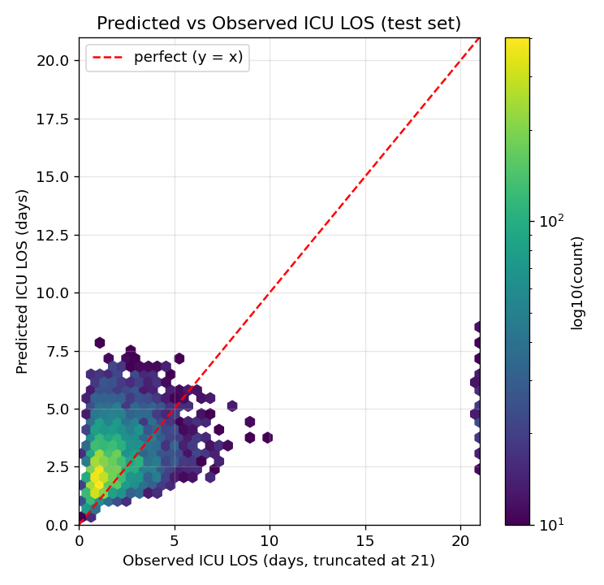
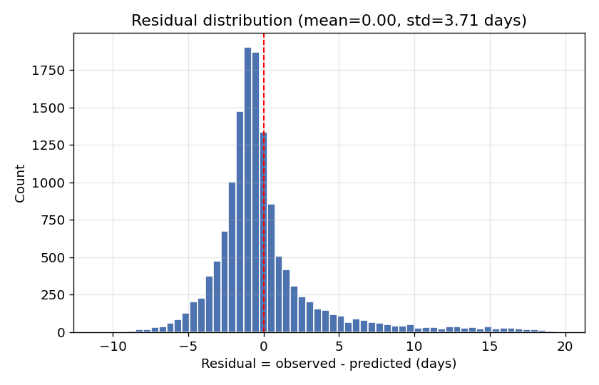
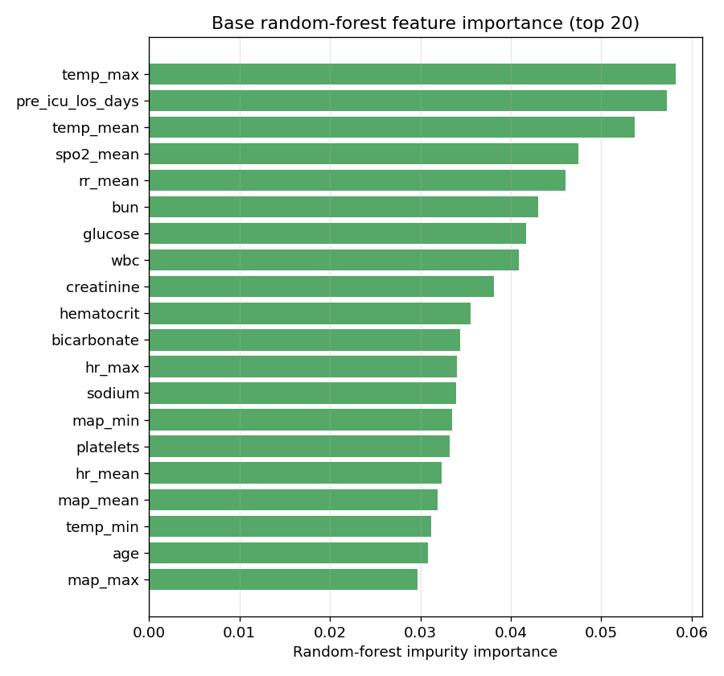
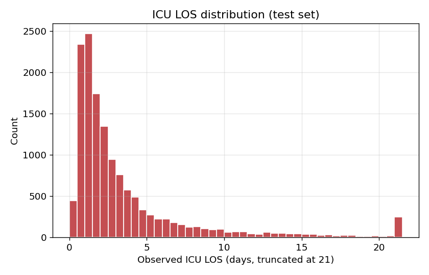
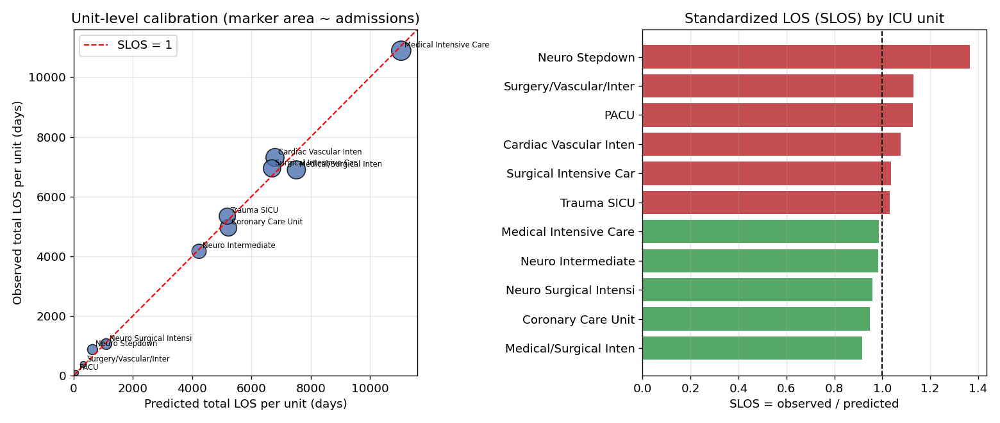

# Replicating an ICU Length-of-Stay Prediction Model on MIMIC-IV

*An EngD replication study. Belhassen Ouerghi, University of Hertfordshire.*

## 1. Overview

This repository is my independent replication of a published machine-learning
experiment: predicting a patient's **intensive-care length of stay (LOS)** at
the moment of ICU admission. The original work is the data-driven ICU-LOS model
of **Peres et al. (2022)**, published as the R `SLOS` package and the
[`igor-peres/ICU-Length-of-Stay-Prediction`](https://github.com/igor-peres/ICU-Length-of-Stay-Prediction)
repository, which fits a **stacked ensemble** and reports a patient-level
R² of approximately **0.17** (RMSE ≈ 4.02 d, MAE ≈ 2.67 d).

My contribution here is a *conceptual replication* rather than a bit-for-bit
reproduction: I re-implement the same regression target, stacking architecture
and evaluation protocol in **Python (`scikit-learn`)**, but re-fit it on the
newer and structurally different **MIMIC-IV v3.1** critical-care database, and I
document precisely where and why the two studies diverge. On a held-out,
patient-level test set of **14,037 ICU stays (9,786 patients)** the replicated
model attains **RMSE 3.71 d, MAE 2.34 d, patient-level R² 0.171, and unit-level
R² 0.994**, matching the upstream benchmark almost exactly on patient-level R²,
the headline discriminative metric, while modestly improving on RMSE/MAE.

I approached this as a research exercise in *reproducibility*: taking a result
from the literature, re-deriving it from first principles on independent data,
and reporting the agreement and the gaps without cherry-picking. I use the first
person to be explicit about the decisions I made.

## 2. Clinical importance

ICU length of stay is a core operational outcome. Predicting it at admission
supports bed management, staffing and step-down planning, and the *standardised*
form of the metric (observed ÷ expected LOS) is a recognised way to benchmark
ICU efficiency across units and hospitals. Because the prediction is made at the
index time of admission, using only the first hours of data, a usable model
must extract acuity signal from routinely-charted physiology rather than from
the eventual trajectory of the stay. That "predict-at-admission" constraint is
what makes ICU-LOS a genuinely hard regression problem and is shared by both the
upstream study and this replication.

## 3. Upstream method and citation

> Peres, I. T., Hamacher, S., Oliveira, F. L. C., Bozza, F. A., & Salluh, J. I. F.
> (2022). *Data-driven methodology to predict the ICU length of stay: A
> multicentre study.* Anaesthesia Critical Care & Pain Medicine.
> https://github.com/igor-peres/ICU-Length-of-Stay-Prediction

The upstream project fits a **stacked ensemble** (via R's `caret` /
`caretEnsemble`) and derives a unit-level **Standardized LOS (SLOS)** metric:

1. **Level-0 base learners**, tuned with 5-fold CV: a linear regression (`lm`)
   and a random forest (`ranger`, tuning `mtry ∈ {5..10}`,
   `splitrule = "variance"`, `min.node.size = 5`).
2. **Level-1 meta-learner:** a second random forest (`ranger`, `mtry = 2`)
   trained on the base learners' out-of-fold predictions.
3. **Post-processing:** predictions clipped to `[0, 21]` days.
4. **SLOS:** per ICU unit, `SLOS = Σ observed / Σ predicted`; the model is also
   assessed by the R² between per-unit predicted and observed LOS totals: an
   operational, benchmarking-style goodness-of-fit.

A fuller reverse-engineering of the upstream R scripts is in
[`docs/upstream-methodology.md`](docs/upstream-methodology.md). My pipeline
preserves the *spirit* of each step (Sections 8 and 9) while adapting the data
access to MIMIC-IV and DuckDB.

## 4. The prediction target

I model ICU LOS as a **supervised regression** problem: predict the number of
days a patient will remain in the ICU, using only information available at (or
shortly after) ICU admission.

- **Unit of analysis:** one ICU stay (`icu/icustays.stay_id`).
- **Prediction / index time:** ICU admission (`intime`). Time-varying predictors
  are aggregated over the first **24 hours** only, so the model never sees
  information from later in the stay.
- **Target:** `UnitLengthStay_trunc`, being ICU LOS in days, truncated to **[0, 21]**,
  mirroring the upstream label/prediction clipping. In MIMIC-IV this is simply
  `clip(icustays.los, 0, 21)`; `los` is already a fractional-day field.

The upstream benchmark I set out to match:

| Metric | Upstream (Peres et al. / repo README) |
|---|---:|
| RMSE | ≈ 4.02 days |
| MAE | ≈ 2.67 days |
| R² (patient-level) | ≈ 0.17 |
| R² (ICU unit-level) | ≈ 0.91 |

## 5. How MIMIC-IV differs, and what I adapted

The upstream model was trained on a Brazilian multicentre ICU **registry** with
purpose-collected fields. MIMIC-IV is a single-centre US EHR extract with a
different schema; several changes forced principled adaptations:

| Aspect | Upstream / registry assumption | MIMIC-IV v3.1 reality | My adaptation |
|---|---|---|---|
| Access | R + local files | Gzipped CSVs, no server | **DuckDB** reads `.csv.gz` directly and aggregates in SQL |
| Schema case | UPPERCASE tables/columns | lowercase | Rewrote all SQL for lowercase |
| ICU-stay key | `ICUSTAY_ID` | `stay_id` | Re-keyed the pipeline on `stay_id` |
| LOS | compute `outtime − intime` | `icustays.los` precomputed (days) | Use `los` directly |
| Age | shifted `DOB`, arithmetic + cap | `patients.anchor_age` | Use `anchor_age ≥ 18` |
| Charting system | CareVue **and** MetaVision itemids | MetaVision-only | Dropped CareVue itemids |
| Labs key | join labs by `hadm_id` | same (`labevents.hadm_id`) | Join on `hadm_id` + time window |
| Comorbidities | curated ICD-9 flag list | ICD-9 **and** ICD-10 mixed | Replaced brittle flag set with first-24 h physiology (Section 7) |
| Registry vitals / ethnicity | present | `race` only, no registry vitals | Not used |

The most consequential decision was the **predictor set**. Rather than force a
fragile ICD-9/ICD-10 comorbidity mapping to imitate the registry flags, I chose
a compact, defensible set that is *analogous in spirit*: demographics, admission
context, and routinely-charted first-day physiology. The modelling target,
architecture, cross-validation and clipping are all kept identical to upstream,
so the comparison remains meaningful. This omission is the main threat to a
strict like-for-like comparison and is discussed in Section 10.

## 6. Cohort, inclusion and exclusion

Built in `src/extract.py` from `icu/icustays` ⋈ `hosp/patients` ⋈
`hosp/admissions`:

- **Adults:** `anchor_age ≥ 18`.
- **Minimum ICU stay** of about 4 hours (`los ≥ 4/24 d`), which removes transfer /
  documentation artefacts.
- **Non-null `los`**; label truncated to `[0, 21]` days.
- **Final cohort: 93,730 ICU stays across 65,241 unique patients**, the full
  eligible MIMIC-IV adult ICU population; no sub-sampling was needed (the DuckDB
  first-24 h aggregation over the 3.5 GB `chartevents` file runs in ≈ 75 s).

| LOS_trunc (days) | value |
|---|---:|
| mean | 3.46 |
| median | 1.98 |
| std | 4.09 |
| max | 21.00 |

**Splitting.** A **patient-level** 70/15/15 train/val/test split on `subject_id`
(seed 42) prevents a patient's repeat ICU stays from leaking across the split
boundary. The final model is fitted on train+val (79,693 stays); the internal
5-fold CV of the stack plays the role of upstream's validation, and the **test
split (14,037 stays / 9,786 patients) is untouched until evaluation**.

## 7. Features and itemids

29 predictors; full itemid table and bounds in
[`docs/feature-spec.md`](docs/feature-spec.md). All time-varying predictors are
aggregated over the **first 24 hours** of the ICU stay.

**Demographics & context (5):** `age`, `gender`, `admission_type`, `unitcode`
(= `first_careunit`), `pre_icu_los_days` (hospital time before ICU).

**First-24 h vital signs** (`icu/chartevents`, MetaVision itemids; mean/min/max):

| Feature | itemid(s) | Feature | itemid(s) |
|---|---|---|---|
| Heart rate | 220045 | Temperature | 223762 (°C), 223761 (°F converted to °C) |
| Respiratory rate | 220210 | Mean arterial pressure | 220052, 220181, 225312 |
| SpO₂ | 220277 | | |

**First-24 h laboratory features** (`hosp/labevents`, mean; itemids shared with
MIMIC-III):

| Feature | itemid(s) | Feature | itemid(s) |
|---|---|---|---|
| Creatinine | 50912 | Bicarbonate | 50882 |
| WBC | 51301, 51300 | BUN | 51006 |
| Glucose (lab) | 50931 | Hematocrit | 51221 |
| Sodium | 50983 | Platelets | 51265 |
| Potassium | 50971 | | |

Physiologic sanity bounds are applied in SQL before aggregation, so a single
erroneous reading (e.g. HR = 10109) cannot dominate a min/max. Missingness is
low (vitals below 3 %, labs about 3 to 4 % null) and is imputed **inside** the model
pipeline (median for numeric, most-frequent for categorical), so imputation is
fit per CV fold and never leaks from test to train. All exact itemids also live
in `config.yaml` for auditability.

## 8. Modelling

Implemented in `src/train.py` with `sklearn`, deliberately mirroring the
upstream stacking design:

```
Level-0 base learners (each in its own preprocessing pipeline)
  ├── LinearRegression            (impute + standardise + one-hot)
  └── RandomForestRegressor       (impute + one-hot; n_estimators=200,
        mtry/max_features chosen from {5..10} by 3-fold CV, min_samples_leaf=5)
        │  out-of-fold predictions via StackingRegressor's internal 5-fold CV
        ▼
Level-1 meta-learner
  └── RandomForestRegressor       (max_features=2, min_samples_leaf=10,
                                   n_estimators=200)
        ▼
  Predictions clipped to [0, 21] days, then SLOS = Σobserved / Σpredicted per unit
```

- `max_features` for the base RF is selected by an internal grid search over
  `{5..10}` (best on this cohort: **10**), mirroring caret's `tuneGrid`.
- The meta-RF's `min_samples_leaf` is fixed to 10, the midpoint of the upstream
  grid `{5, 10, 15, 20}`.
- All hyperparameters live in [`config.yaml`](config.yaml); the pipeline is
  fully config-driven.

## 9. Replication results

Held-out test set: **14,037 ICU stays (9,786 patients)**. Full table in
[`results/results_table.md`](results/results_table.md); raw numbers in
[`results/metrics.json`](results/metrics.json).

| Metric | This replication (MIMIC-IV) | Upstream benchmark |
|---|---:|---:|
| RMSE (days) | **3.708** | 4.02 |
| MAE (days) | **2.343** | 2.67 |
| R² (patient-level) | **0.171** | 0.17 |
| R² (unit-level) | **0.994** | 0.91 |
| Overall SLOS | 1.001 | 1.00 (by construction) |

**Figures** (`results/plots/`):

- **Predicted vs observed ICU LOS** (test set), as a hexbin density with the 45° line:
  
- **Residual distribution** (observed − predicted):
  
- **Base random-forest feature importance** (top 20):
  
- **Observed ICU-LOS distribution** (test set):
  
- **Per-ICU-unit calibration and Standardized LOS (SLOS)**, the operational,
  funnel-style view:
  

## 10. Agreement and divergence vs upstream

I read this as a successful conceptual replication, in that the same method on
independent data recovers a model of the same discriminative power, while being
candid about where the numbers differ and why:

1. **Patient-level R² is essentially identical (0.171 vs 0.17).** This is the
   headline: a single-centre US EHR cohort with a physiology-based feature set
   reproduces the upstream registry model's discriminative power almost exactly.
   It also reflects a genuine ceiling: day-1 ICU data explains only a modest
   fraction of LOS variance, consistent with the LOS-prediction literature.
2. **RMSE/MAE are lower (better) than upstream (3.71 vs 4.02; 2.34 vs 2.67).**
   I read this cautiously: absolute error depends on the LOS distribution of the
   cohort, and MIMIC-IV's truncated-LOS distribution (mean 3.46 d) differs from
   the Brazilian registry's, so a lower RMSE is not strictly a "better model":
   it is a comparable model on a somewhat different distribution.
3. **Unit-level R² is very high (0.994 vs 0.91).** Aggregating to ~13 ICU units
   averages out per-patient noise, and the model is well-calibrated in aggregate
   (overall SLOS = 1.001). MIMIC-IV's smaller set of large, relatively
   homogeneous units makes the unit-level fit tighter than upstream's
   multicentre setting; I would not over-interpret the gap.
4. **Feature importances are clinically plausible:** first-day temperature,
   pre-ICU hospital time, SpO₂ / respiratory rate, and renal/haematologic labs
   (BUN, glucose, WBC, creatinine) dominate, which are the usual acuity signals.
5. **Divergence from upstream inputs:** I did not reproduce the registry
   comorbidity/treatment flags (Section 5). This is the main threat to a strict
   like-for-like comparison and is stated openly.

None of these are bugs; they are the price of an honest cross-database
replication. The headline finding, that routinely collected first-day ICU data
recovers the upstream model's patient-level discriminative power, reproduces
robustly.

## 11. Reproducibility

```bash
# Environment: duckdb, pandas, pyarrow, numpy, scikit-learn, joblib, pyyaml,
# matplotlib (see research/requirements.txt). Set mimic_dir in config.yaml first.
PY=python3

make extract PY=$PY   # writes data/derived/{cohort,features}.parquet  (DuckDB over .csv.gz)
make train   PY=$PY   # writes models/stacking_model.joblib  (+ patient-level splits)
make eval    PY=$PY   # writes results/metrics.json, results_table.md, plots/
```

- **`config.yaml`** centralises every path, itemid, window, bound and
  hyperparameter, so the experiment is fully specified in one auditable file.
- Random seeds are fixed (`random_state = 42`): the patient-level split and all
  learners are deterministic.
- The large `chartevents` (3.5 GB) file is read **directly from gzip by DuckDB**,
  filtered to the cohort and itemids and aggregated in SQL. It is **never**
  loaded whole into pandas. End-to-end wall-clock on a laptop: extract ≈ 2 min,
  train ≈ 2 min, evaluate + visualise < 1 min.
- MIMIC-IV access requires PhysioNet credentialing and the data-use agreement;
  the data are not, and must not be, in this repository.

**Pipeline layout**

```
src/extract.py    cohort + first-24h feature aggregation (DuckDB over .csv.gz)
src/data.py       shared dataset load, patient-level split, preprocessing
src/train.py      stacking ensemble (mtry search, then StackingRegressor, 5-fold CV)
src/evaluate.py   test metrics, SLOS, per-unit table, feature importances
src/visualize.py  five aggregate diagnostic plots
```

## 12. Limitations and next steps

- **Feature parity:** no comorbidity/treatment flags (ICD-9/10 mixing in
  MIMIC-IV). Next step: build a validated Elixhauser/Charlson mapping over both
  ICD versions and add the flags back for a stricter comparison.
- **Single centre:** MIMIC-IV is one US academic hospital; SLOS benchmarking is
  most meaningful across centres. External validation (e.g. eICU) is future work.
- **Label truncation at 21 d** discards the long right tail; a two-part model
  (short-stay regression + long-stay classifier) may help extreme cases.
- **Meta-learner tuning** is fixed rather than grid-searched over the full
  upstream `{splitrule × min.node.size}` grid; the marginal gain is expected to
  be small but is untested here.

## 13. Data use and ethics

This work uses **MIMIC-IV v3.1**, a de-identified critical-care database released
by the MIT Laboratory for Computational Physiology via PhysioNet under a
data-use agreement that requires completion of human-subjects research training.
**No patient-level data are committed to this repository.** The `.gitignore`
blocks all data, database, model and per-patient derived files (`data/`,
`models/`, `*.csv`, `*.csv.gz`, `*.parquet`, `*.feather`, `*.arrow`, `*.db`,
`*.duckdb`); only source code, configuration, documentation, **aggregate**
metrics and **aggregate** figures are tracked. Every figure shows a distribution
or a per-unit aggregate, never a table of individual patients. Anyone
reproducing this must obtain their own credentialed MIMIC-IV access; this
repository does not redistribute the data. This model is a research artefact and
is **not** a validated medical device; it must not be used for clinical
decision-making.

---

*Reference:* Johnson, A., Bulgarelli, L., Pollard, T., et al. *MIMIC-IV* (version
3.1). PhysioNet (2024). Upstream: Peres, I. T., et al. (2022),
[igor-peres/ICU-Length-of-Stay-Prediction](https://github.com/igor-peres/ICU-Length-of-Stay-Prediction).
Replication study by the author (EngD, University of Hertfordshire).
