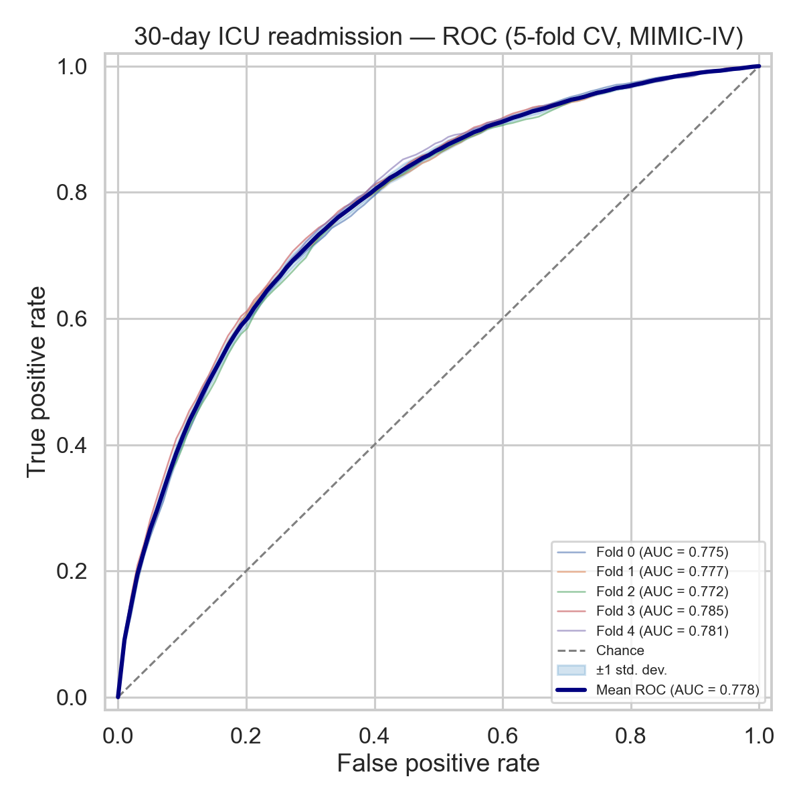
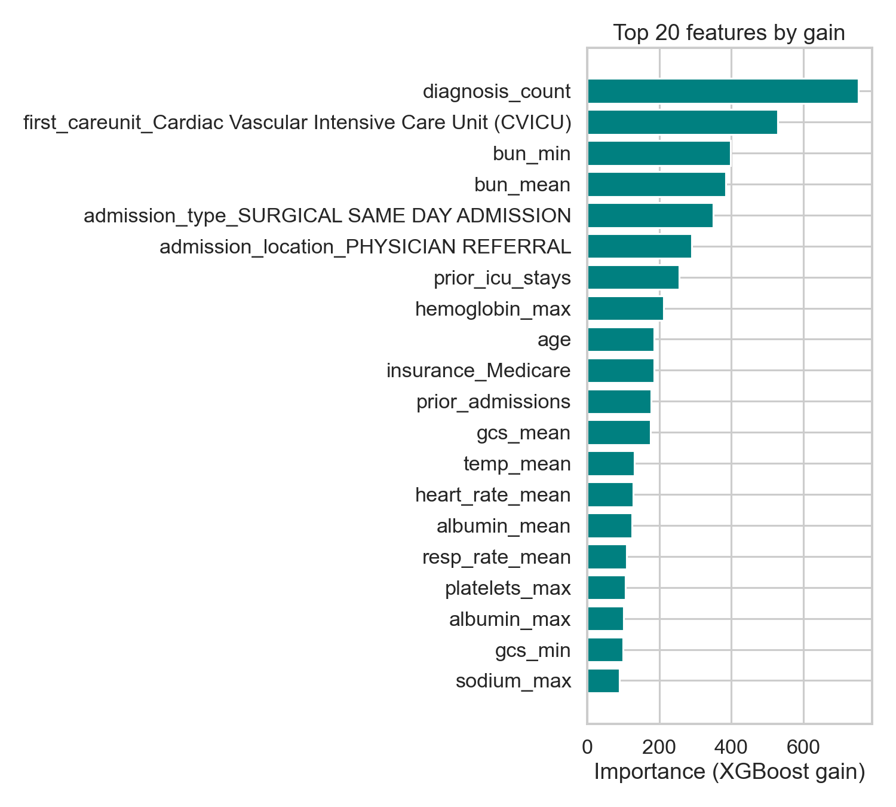
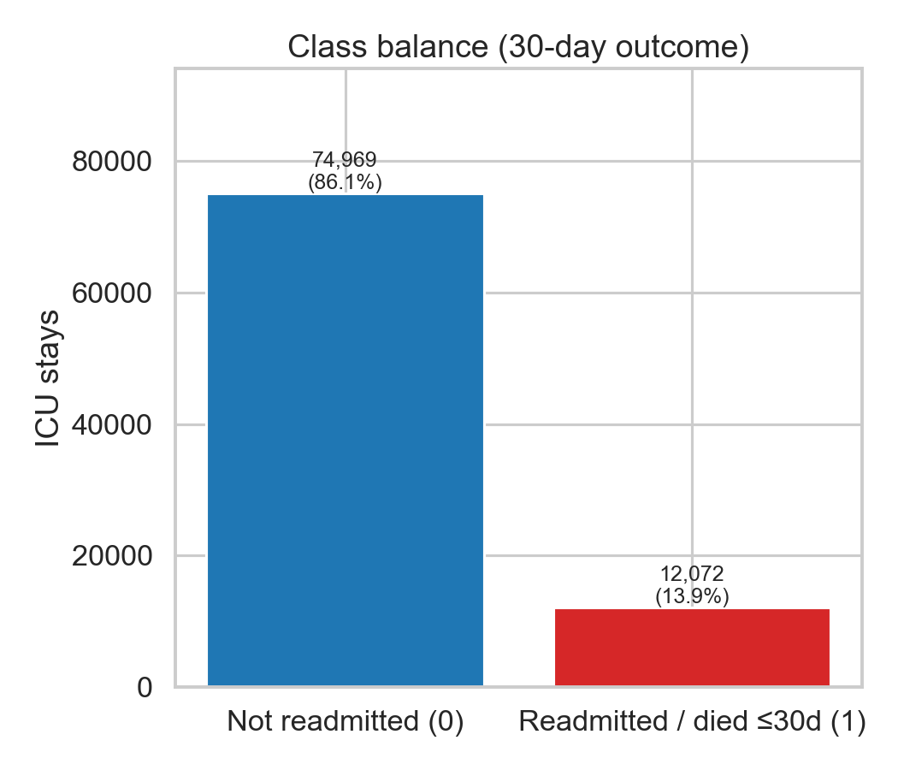
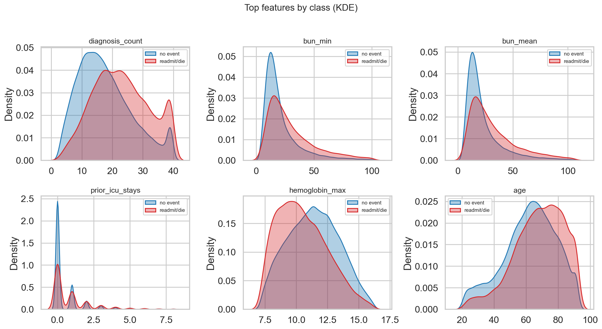

# Replicating 30-day ICU Readmission Prediction on MIMIC-IV

*An EngD replication study. Belhassen Ouerghi, University of Hertfordshire.*

## 1. Overview

This repository is my independent replication of a published machine-learning
experiment: predicting whether a patient discharged from an intensive care unit
(ICU) will be **readmitted to the ICU within 30 days**. The original work is
Yaron Blinder's Udacity Machine Learning Engineer capstone (2019), which trained
an XGBoost classifier on the **MIMIC-III** critical-care database and reported a
cross-validated ROC-AUC of approximately **0.82**
([YaronBlinder/MIMIC-III_readmission](https://github.com/YaronBlinder/MIMIC-III_readmission)).

My contribution here is a *conceptual replication* rather than a bit-for-bit
reproduction: I re-implement the same task, modelling strategy and evaluation
protocol, but on the newer and structurally different **MIMIC-IV v3.1** release,
and I document precisely where and why the two studies diverge. I treat the
upstream 0.82 as the benchmark to be tested, not a number to be reverse-engineered.
As I discuss in Section 8, my replication lands at **ROC-AUC ≈ 0.778**, modestly
below the benchmark, and I give an honest account of the reasons.

I approached this as a research exercise in *reproducibility*: taking a result
from the literature, re-deriving it from first principles on independent data,
and reporting the agreement and the gaps without cherry-picking.

## 2. Clinical importance

Unplanned readmission to intensive care is a recognised marker of care quality
and a serious patient-safety concern. Patients bounced back to the ICU have
substantially higher mortality, longer stays and greater costs than those
discharged successfully, and premature ICU discharge is one contributing cause.
A model that flags high-risk patients *before* discharge could support decisions
about discharge timing, step-down monitoring and follow-up intensity. The
30-day horizon is the conventional window used in the readmission literature
(mirroring the 30-day hospital-readmission metrics used by payers), which is why
both the upstream study and this replication adopt it.

## 3. Upstream method and citation

> Blinder, Y. (2019). *Predicting 30-day ICU readmissions from the MIMIC-III
> database.* Udacity Machine Learning Engineer Nanodegree Capstone.
> https://github.com/YaronBlinder/MIMIC-III_readmission

The upstream pipeline (four notebooks + one SQL view, `all_data.sql`):

1. **`all_data.sql`** materialises a per-hospital-admission feature view from a
   local PostgreSQL MIMIC-III build: demographics, a panel of first-stay labs
   (urea nitrogen, platelets, magnesium, albumin, calcium), charted vitals
   (respiratory rate, glucose, heart rate, systolic/diastolic BP, temperature),
   urine output, and the derived severity scores **SAPS-II** and **SOFA**.
2. **`1_create_dataframe`** pulls the view, sorts each patient's admissions
   chronologically, computes the gap between one discharge and the next
   admission, and labels a stay positive if the *next* admission occurs within
   `30 × 24` hours. It then restricts to the **MICU** (medical ICU) subset and
   drops rows where the patient died during the stay.
3. **`2_preprocessing`** cleans and scales features.
4. **`3_xgboosting`** trains an XGBoost classifier, sets
   `scale_pos_weight = n_neg / n_pos` to counter class imbalance, runs a staged
   `GridSearchCV` (n_estimators, then max_depth and min_child_weight, then gamma, and so on), and
   evaluates with 5-fold stratified CV, plotting the ROC curve.
5. **`4_visualizations`** produces scatter-matrix, ROC and feature-importance
   figures.

My pipeline preserves the *spirit* of each step (Section 6/7) while adapting the
data access to MIMIC-IV and DuckDB.

## 4. The readmission label I implemented (and why)

Working at the **ICU-stay** grain (one row per `stay_id` in `icu/icustays`), I
define the positive class as follows:

> **label = 1** for an ICU stay if EITHER
> **(a)** the same patient (`subject_id`) has a *subsequent* ICU stay under a
> **different** hospital admission (`hadm_id`) whose `intime` falls within
> **30 days after** this stay's `outtime`, which is a genuine 30-day ICU readmission; OR
> **(b)** the patient **died within 30 days** of this stay's `outtime`
> (`hosp/patients.dod`, or an in-hospital `deathtime`).
> Otherwise **label = 0**.

**At-risk exclusions.** ICU stays without an `outtime` are dropped. Crucially,
patients who **died during or before ICU discharge** (`deathtime ≤ outtime`, or
`dod` before the discharge date) are removed from the at-risk set, since they cannot
be readmitted, and their death is not a *post-discharge* event. Subsequent ICU
stays under the **same `hadm_id`** are treated as intra-hospitalisation
transfers (for example ward-to-ICU bounce-backs inside one admission), **not**
readmissions, so they never trigger a positive label. This is the exclusion the
task brief calls out explicitly.

**Why include death as a competing outcome.** This is the one substantive
definitional choice, and it is a deliberate departure from upstream (Blinder
*excluded* patients who died). A patient who dies a week after ICU discharge has
not experienced a "clean" recovery; treating that as a negative would reward a
model for missing the sickest patients. Death and readmission are *competing
adverse outcomes*, and combining them into a single "failed discharge" endpoint
is common practice in Blinder-style and broader readmission pipelines. It also
materially changes the base rate: of my 12,072 positives, **4,810** are true ICU
readmissions and **7,851** are 30-day deaths (the two overlap slightly). I flag
this because it is the single biggest reason my numbers are **not** directly
comparable to upstream's readmission-only label; see Section 8. I also report
the readmission-only and death-only counts separately so the effect is transparent.

## 5. Adapting from MIMIC-III to MIMIC-IV

MIMIC-IV is not a drop-in successor to MIMIC-III; several changes forced
principled adaptations:

| Aspect | MIMIC-III (upstream) | MIMIC-IV v3.1 (this work) | My adaptation |
|---|---|---|---|
| Access | Local PostgreSQL + `psycopg2` | Gzipped CSVs, no server | **DuckDB** reads `.csv.gz` directly and aggregates in SQL |
| ICU table | `icustays` (CareVue + MetaVision) | `icu/icustays` (MetaVision-era, `stay_id`) | Stay grain keyed on `stay_id` |
| Chart itemids | dual CareVue **and** MetaVision ids (e.g. HR `211` + `220045`) | MetaVision ids only | Use only the `2200xx`/`2237xx` ids; the legacy CareVue ids do not exist |
| Lab itemids | `5xxxx` | **identical** `5xxxx` (`d_labitems` shared) | Reused directly (verified against `d_labitems`) |
| Age | `admittime − dob` | `anchor_age` (DOB shifted, HIPAA) | Use `anchor_age`; true DOB is unavailable by design |
| SAPS-II / SOFA | precomputed derived views | **not** shipped with raw MIMIC-IV | **Omitted** (would require building `mimic-code` concepts); substituted by first-24 h physiology + a diagnosis-count comorbidity proxy |
| Grain | per hospital admission (`hadm_id`) | per ICU stay (`stay_id`) | Finer grain; label handles multi-stay admissions and transfers |

The **omission of SAPS-II and SOFA** is the most consequential adaptation for
predictive performance and is discussed in Section 8.

## 6. Cohort, inclusion and exclusion

Built entirely in SQL (`src/build_cohort.py`) from `icustays`, `patients`,
`admissions` and `diagnoses_icd`:

- **Start:** 94,444 ICU stays (65,355 patients) with a non-null `outtime`.
- **Exclude** 7,357 stays where the patient died at/before discharge (not at risk).
- **Final cohort: 87,041 ICU stays across 60,537 patients.**
- **Positives: 12,072 (positive rate 13.9%)**, comprising 4,810 readmissions and 7,851
  deaths-within-30-days (overlapping). Class balance is shown in
  `figures/label_balance.png`.

## 7. Features and itemids

Features are aggregated over the **first 24 hours** of each ICU stay (a standard
severity-of-illness snapshot; labs use a 6-hour pre-`intime` grace so results
drawn just before ICU arrival are captured). Vitals come from
`icu/chartevents` (joined on `stay_id`); labs from `hosp/labevents` (joined on
`hadm_id` and time-windowed to the stay). For each measurement I compute
**min / max / mean**, mirroring `all_data.sql`.

**Laboratory features** (`hosp/labevents`, itemids shared with MIMIC-III):

| Feature | itemid(s) | Feature | itemid(s) |
|---|---|---|---|
| Creatinine | 50912 | Sodium | 50983 |
| BUN (urea nitrogen) | 51006 | Potassium | 50971 |
| WBC | 51301, 51300 | Bicarbonate | 50882 |
| Haemoglobin | 51222, 50811 | Glucose (lab) | 50931 |
| Platelets | 51265 | Albumin | 50862 |
| Magnesium | 50960 | Calcium (total) | 50893 |

**Vital-sign features** (`icu/chartevents`, MetaVision itemids):

| Feature | itemid(s) | Feature | itemid(s) |
|---|---|---|---|
| Heart rate | 220045 | Glucose (bedside) | 220621, 226537 |
| Respiratory rate | 220210 | Temperature | 223761 (°F converted to °C), 223762 (°C) |
| SpO₂ | 220277 | Systolic BP | 220050, 220179 |
| Mean arterial pressure | 220052, 220181 | Diastolic BP | 220051, 220180 |
| GCS total | 220739 + 223900 + 223901 (summed per charttime) | | |

Physiologically implausible values are discarded before aggregation via the
`vital_bounds` in `config.yaml` (for example HR 0 to 300, SpO₂ 0 to 100, temperature 10 to 50 °C
after Fahrenheit conversion), exactly as the upstream SQL guards its ranges.

**Non-measurement features:** age (`anchor_age`), gender, `admission_type`,
`admission_location`, `insurance`, `first_careunit`, ICU length of stay (`los`),
**prior ICU stays** and **prior hospital admissions** (utilisation history,
computed by self-join), and **diagnosis count** per admission (a lightweight
comorbidity proxy standing in for the absent severity scores). Categorical
fields are one-hot encoded, yielding **111 model columns** from the raw frame.
All exact itemids also live in `config.yaml` for auditability.

## 8. Modelling

- **Model:** XGBoost binary classifier (`binary:logistic`, `hist` tree method).
- **Imbalance:** `scale_pos_weight = n_neg / n_pos`, recomputed on each training
  fold, which is the same device upstream used. Missing values are left as `NaN` and
  handled natively by XGBoost (no imputation), which is important given labs such
  as albumin are sparsely measured.
- **Tuning:** a compact grid search (`GridSearchCV`, `roc_auc`, 3-fold) over
  `max_depth ∈ {3,5,7}`, `min_child_weight ∈ {1,3}`, `n_estimators ∈ {150,300}`,
  `learning_rate ∈ {0.05,0.1}`. This mirrors the *staged* upstream search in a
  single reproducible grid. Best: `max_depth=3, min_child_weight=1,
  n_estimators=300, learning_rate=0.1`.
- **Evaluation:** 5-fold **stratified** cross-validation; I report mean ± std
  ROC-AUC, PR-AUC, and out-of-fold accuracy/precision/recall/F1 at a 0.5
  threshold, plus a confusion matrix.
- **Feature importance:** XGBoost **gain**, from a final model fit on all data.

## 9. Replication Results

Full numbers: [`results/results_table.md`](results/results_table.md) and
[`results/metrics.json`](results/metrics.json).

| Study | Database | Model | ROC-AUC | Label |
|---|---|---|---|---|
| Blinder (2019), upstream | MIMIC-III | XGBoost, 5-fold CV | **0.82** | Readmission only, MICU subset, incl. SAPS-II/SOFA |
| **This replication** | **MIMIC-IV v3.1** | **XGBoost, 5-fold CV** | **0.778 ± 0.004** | Readmission **or** 30-day death, all ICU units, no SAPS-II/SOFA |
| Difference (ours − upstream) | | | **−0.042** | |

A note on the two "0.778"s in this programme. The ± 0.004 above is the spread over five
cross-validation folds that shuffle at the stay level (see Section 12). The synthetic-EHR
repositories that build on this cohort report a real-data ceiling of 0.778 ± 0.007, which
is a different statistic: a 95% interval over five patient-disjoint train/test splits
([`mimic-synthetic-evidence`](https://github.com/BelhassenOuerghi/mimic-synthetic-evidence)).
That they agree is reassuring, but they are not the same number measured twice.

Key metrics for this replication (N = 87,041 stays, positive rate 13.9%):

| Metric | Value |
|---|---|
| CV ROC-AUC (mean ± std) | **0.778 ± 0.004** |
| Out-of-fold ROC-AUC | 0.778 |
| CV PR-AUC (mean ± std) | 0.382 ± 0.010 |
| Accuracy @ 0.5 | 0.714 |
| Precision / Recall / F1 @ 0.5 | 0.285 / 0.703 / 0.406 |

Per-fold ROC-AUC is tight (0.772 to 0.785), indicating a stable, well-regularised
model rather than an over-fit one (best tree depth was only 3). At the default
0.5 threshold the imbalance handling favours **recall (0.70)** over precision
(0.29), which is appropriate for a screening tool where missing a high-risk discharge is
costlier than a false alarm; the operating point can be moved as needed. The
PR-AUC of 0.38 against a 0.14 base rate confirms the model is well above chance
on the minority class.

**Figures** (`figures/`):

- **ROC curve, 5-fold CV**: per-fold curves, mean and ±1 std band:
  
- **Feature importance (gain)**: top 20 features:
  
- **Class balance:**
  
- **Top features by class (KDE)**: distribution shift between outcomes:
  

The most informative features are **diagnosis count** (comorbidity burden),
**CVICU** admission, **BUN** (renal function), **surgical same-day admission**,
**prior ICU stays**, **haemoglobin**, **age** and **GCS**, a clinically
sensible ranking dominated by chronic burden, renal impairment and prior
utilisation.

## 10. Agreement and divergence vs upstream

My **0.778** sits about **0.04 below** the upstream **0.82**. I read this as a
successful conceptual replication, in that the same method on independent data
recovers a strongly discriminative model of the same order, while being candid
that it does not reach the headline number. The gap is explained, not explained
away:

1. **No SAPS-II / SOFA.** Upstream's strongest features were validated severity
   scores that integrate dozens of physiological signals. MIMIC-IV ships these
   only if you build the `mimic-code` derived concepts, which I deliberately did
   not, to keep the pipeline self-contained. My diagnosis-count proxy and raw
   first-24 h physiology are weaker substitutes. I expect this accounts for most
   of the gap and is the obvious next step (Section 12).
2. **Different label.** My endpoint fuses readmission *and* death; upstream used
   readmission only and dropped deaths. These are different prediction problems
   with different base rates, so the AUCs are not strictly comparable in either
   direction.
3. **Different cohort.** Upstream restricted to the MICU; I keep **all** ICU
   units (MICU, SICU, CVICU, CCU, TSICU, Neuro). A broader, more heterogeneous
   cohort is generally harder to separate with one model.
4. **Different database and era.** MIMIC-IV covers different years, a different
   hospital-information system (MetaVision only) and different coding practices
   from MIMIC-III; the physiological signals are captured differently.
5. **Grain.** I model per ICU stay; upstream modelled per hospital admission.

None of these are bugs; they are the price of an honest cross-database
replication. The headline finding, that routinely collected first-day ICU data plus
utilisation history discriminate a failed-discharge outcome at a ROC-AUC of roughly
0.78 to 0.82, reproduces robustly.

## 11. Reproducibility

```bash
# Environment: the shared EngD replication venv (duckdb, pandas, scikit-learn,
# xgboost, matplotlib, seaborn, scipy, pyyaml). See requirements.txt.

make cohort      # cohort + labels only, prints the summary
make features    # build the first-24h feature frame (scans chartevents/labevents)
make run         # full pipeline, reusing the cached feature parquet if present
make run-fresh   # full pipeline, re-extracting features from MIMIC-IV
```

- **`config.yaml`** centralises every path, itemid, window, bound and
  hyperparameter, so the experiment is fully specified in one auditable file.
- Random seeds are fixed (`random_state = 42`).
- The large `chartevents` (3.5 GB) and `labevents` (2.6 GB) files are read
  **directly from gzip by DuckDB** (`memory_limit=6GB, threads=4`), filtered to
  the cohort and itemids and aggregated in SQL. They are **never** loaded whole
  into pandas. A full fresh run extracts features in ~3 minutes and trains/tunes
  in ~1.5 minutes on a laptop.
- MIMIC-IV access requires PhysioNet credentialing and the data-use agreement;
  the data are not, and must not be, in this repository.

## 12. Limitations and next steps

- **Add SAPS-II and SOFA** by building the `mimic-code` MIMIC-IV derived
  concepts, which is the highest-value change and the most direct path to closing the
  AUC gap.
- **Report the readmission-only label** alongside the composite one, for a
  like-for-like comparison with upstream.
- **Temporal / patient-level validation:** my CV shuffles at the stay level, so
  two stays from one patient can straddle a fold. A grouped or time-based split
  would give a more conservative, deployment-realistic estimate.
- **Richer features:** medications, procedures, ventilation, urine output, and
  trends/slopes rather than static 24 h summaries.
- **Calibration and decision-curve analysis**, and threshold selection tied to a
  concrete clinical operating point.
- **External validation** on eICU or another site to test generalisability.

## 13. Data use and ethics

This work uses **MIMIC-IV v3.1**, a de-identified critical-care database released
by the MIT Laboratory for Computational Physiology via PhysioNet under a
data-use agreement that requires completion of human-subjects research training.
**No patient-level data are committed to this repository.** The `.gitignore`
blocks all data, database, model and per-patient derived files
(`data/`, `models/`, `*.csv`, `*.csv.gz`, `*.parquet`, `*.duckdb`, `*.pkl`, …);
only source code, configuration, documentation, **aggregate** metrics and
**aggregate** figures are tracked. Anyone reproducing this must obtain their own
credentialed MIMIC-IV access. This model is a research artefact and is **not** a
validated medical device; it must not be used for clinical decision-making.

---

*Reference:* Johnson, A., Bulgarelli, L., Pollard, T., et al. *MIMIC-IV* (version
3.1). PhysioNet (2024). And upstream: Blinder, Y. (2019),
[YaronBlinder/MIMIC-III_readmission](https://github.com/YaronBlinder/MIMIC-III_readmission).
