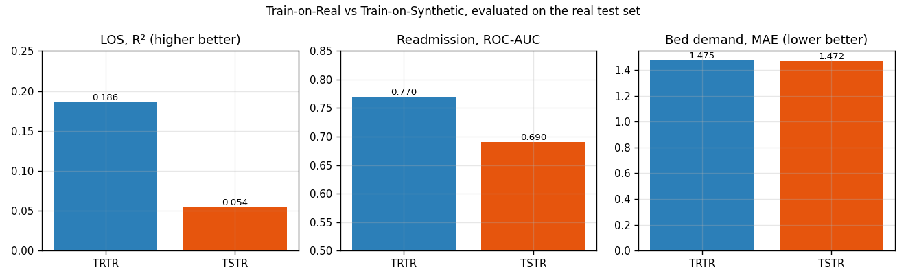
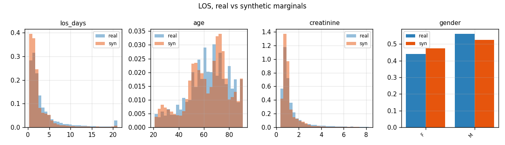
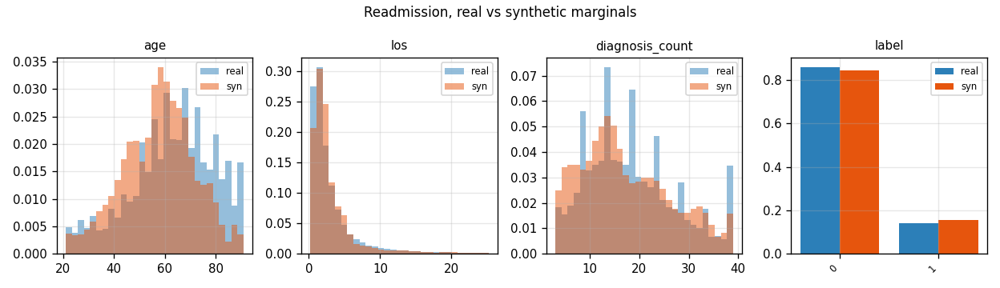
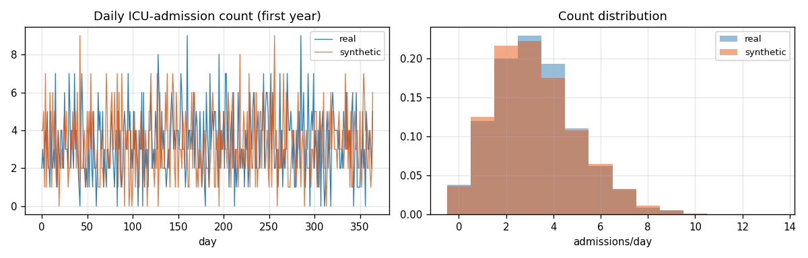

# Synthetic EHR with CTGAN: a utility baseline for a four-pillar programme

*Part of [SynthEHR](../../README.md), an independent research programme by Belhassen Ouerghi. [All research stages](../README.md).*

## 1. Overview

This folder is the first stage of my research on synthetic electronic
health records. The three foundation studies
([length of stay](../foundations/length-of-stay),
[readmission](../foundations/readmission),
[bed demand](../foundations/bed-demand))
train and evaluate prediction models on real MIMIC-IV data. This one asks the
central question: what happens when the training data is synthetic?

I select CTGAN (Conditional Tabular GAN) as the base generator, implement it from
scratch under an MIT licence, fit it to the real patient-level cohorts behind
those three tasks, and measure how much predictive signal survives synthesis. The
measurement uses the standard train-on-synthetic, test-on-real (TSTR) protocol
against a train-on-real, test-on-real (TRTR) ceiling. The number this establishes
is the utility of synthetic EHR *before* any privacy, fairness, ethics or realism
intervention, and it is the reference point against which each of the four
pillars is later measured. Section 7 sets out that ladder. This is Stage 0.

## 2. Why synthetic data, and why this study

Sharing EHR is hard: the analytic value is real, but so is the re-identification
risk. Synthetic data promises to decouple the two, by releasing a generated
dataset while keeping the patients private. The promise is conditional. A
synthetic dataset is only worth generating if a model trained on it still works
on real patients, and only worth releasing if it does not leak the people it was
derived from. My research studies that trade-off end to end across four pillars:
privacy, bias mitigation, ethical and regulatory compliance, and realism.
Everything begins with an honest measurement of raw utility, because every
safeguard added later can only cost utility. That baseline is what this
stage delivers.

## 3. The chosen technique: CTGAN, and why

Choosing the base generator is the load-bearing decision, because each pillar is
implemented as a modification of the generator or of its training objective. I
select CTGAN (Xu et al., NeurIPS 2019) for five reasons, argued in full in
[`doc/research-paper.md`](doc/research-paper.md).

1. It fits the data shape. MIMIC feature matrices are mixed-type, with multimodal
   non-Gaussian labs and vitals alongside imbalanced categoricals. CTGAN's
   mode-specific normalisation (per-column Gaussian mixtures) and its
   training-by-sampling scheme address exactly these pathologies.
2. Its conditional generator is the hook the bias pillar will need.
   Fairness-aware generation requires conditioning on sensitive attributes, and
   CTGAN conditions by construction. Pillar 2 therefore becomes a change to how
   the conditional column is chosen, rather than a new architecture.
3. Its adversarial critic is the hook the privacy pillar will need. Differential
   privacy attaches cleanly as DP-SGD on the critic, or as a PATE ensemble, and
   both are drop-in modifications of CTGAN's training loop.
4. It is the field's reference baseline, which the cross-family benchmark in the
   programme requires.
5. It can be kept licence-clean. The `sdv` and `ctgan` packages are
   Business-Source Licensed and excluded from this programme, so CTGAN is
   re-implemented from scratch in [`research/common/ctgan.py`](../common/ctgan.py) under MIT. A
   side benefit is that every mechanism a later pillar will touch is explicit and
   editable rather than buried in a dependency.

CTGAN is deliberately not the highest-fidelity generator available. Realism is
Pillar 4, to be earned last rather than assumed first. Starting from a
mid-fidelity but maximally extensible baseline is the right ordering for a study
about trade-offs, because it leaves head-room in which the realism intervention
can be shown to work or fail.

Bed demand is a temporal task, and an i.i.d. tabular GAN cannot synthesise a
single autocorrelated count series. For that task the generator is the
modality-appropriate counterpart, a Poisson autoregressive sampler. I state this
as a scope decision, and note a dedicated time-series synthesiser as future work.

## 4. Data

All real data are the derived, de-identified feature matrices built by the three
foundation studies from MIMIC-IV v3.1. Raw MIMIC is never touched here.

| Task | Grain | Rows (train / test) | Features | Target |
|---|---|---|---|---|
| Length of stay | ICU stay | 79,693 / 14,037 | 29 | truncated LOS in days (regression) |
| Readmission | ICU stay | 69,699 / 17,342 | 72 | 30-day failed discharge (binary) |
| Bed demand | day | 3,289 / 364 | n/a | daily ICU-admission count (temporal) |

Both hold-out real test sets are withheld entirely from synthesis, which is what
makes the TSTR comparison valid: no leakage can inflate it. Splits are
patient-disjoint (see Section 6.2).

## 5. Method

* **Generator** (`research/common/ctgan.py`). A faithful CTGAN: per-column variational
  Gaussian-mixture normalisation, a conditional generator with
  training-by-sampling (categories drawn in proportion to log-frequency), a
  WGAN-GP critic with gradient penalty and PacGAN packing, and the conditional
  cross-entropy term. The model is fitted on a subsample of each real training
  split to respect a CPU budget, then sampled up to the full training-set size,
  so that real and synthetic training sets are equal in size. Hyper-parameters
  live in [`config.yaml`](config.yaml).
* **Temporal counterpart** (`research/common/beddemand_gen.py`). A Poisson-AR process fitted
  to the real training span and sampled to a synthetic trajectory of equal
  length.
* **Evaluation** (`src/evaluate_utility.py`). TSTR against TRTR, with an
  identical downstream model per task so that only the training set changes, all
  scored on the real test set: length of stay with a RandomForest (RMSE, MAE,
  R²), readmission with XGBoost (ROC-AUC, PR-AUC), bed demand with a Poisson-AR
  forecaster (MAE, RMSE).

## 6. Results

### 6.1 Headline figures

The authoritative numbers come from the five-seed re-run on patient-disjoint
splits, reported in
[`research/evidence`](../evidence).
They are given as mean plus or minus a 95% confidence interval.

| Task (downstream model) | Metric | TRTR (train real) | TSTR (train synthetic) |
|---|---|---|---|
| Length of stay (RandomForest) | R² | 0.186 ± 0.001 | 0.009 ± 0.083 |
| Readmission (XGBoost) | ROC-AUC | 0.778 ± 0.007 | 0.690 ± 0.018 |
| Readmission (XGBoost) | PR-AUC | 0.379 ± 0.014 | 0.246 ± 0.020 |
| Bed demand (Poisson-AR) | MAE | 1.475 ± 0.000 | 1.475 ± 0.005 |

The cost of synthesis is statistically significant on both tabular tasks (paired
t-test across seeds: readmission p = 0.0002, length of stay p = 0.004).

The three tasks span the full range of outcomes. Bed demand survives synthesis
essentially intact, because the Poisson-AR sampler preserves the low-order
temporal statistics (mean level and first-order autocorrelation) that the
downstream forecaster consumes. Readmission retains most of its signal: a TSTR
ROC-AUC of 0.690 keeps roughly two-thirds of the above-chance discrimination, and
the sharper fall in PR-AUC shows that the minority-class structure is the first
casualty. Length of stay is the most severe case: the synthetic cohort reproduces
the marginal distributions well (see the fidelity figure below) but carries little
of the cross-feature conditional structure the RandomForest depends on, and R²
falls to a value indistinguishable from zero. Marginals preserved with joint
dependencies lost is the canonical limitation of a mid-fidelity tabular GAN, and
it is the head-room the realism pillar must recover.

One point deserves emphasis, because it is easy to misread. On bed demand the
TSTR error is occasionally *lower* than TRTR. This is a tie, not a case of
synthetic data beating real data. The two arms' forecasts never differ by more
than 0.05 admissions per day across the whole test year, the sign of the
difference reverses under RMSE, and by the data-processing inequality a randomised
function of the training data cannot carry more information about the test period
than the training data itself. The apparent edge comes from the refitted
autoregressive coefficient shrinking slightly, which flattens the forecast in a
way that MAE mildly rewards and RMSE mildly penalises.

### 6.2 Corrections to earlier versions of this section

Two defects in the first version of this study were found and fixed, and I record
them here rather than editing them out of history.

The first was a data-leakage defect. The readmission cohort holds 87,041 ICU
stays from only 60,537 patients, and the original split was row-level, which put
6,046 patients on both sides of it. Roughly 43% of the test set consisted of
patients the model had already seen. The split is now patient-disjoint
(`GroupShuffleSplit` on `subject_id`), and the loader refuses to run if patient
identifiers are unavailable. The effect on the TRTR ceiling turned out to be
small (about 0.011 ROC-AUC), but the same defect invalidated the
membership-inference evaluation in Stage 1, whose non-members must be patients
the generator never saw.

The second was a reporting defect, and it was mine. An earlier version of this
section argued that doubling the training budget "lifted LOS R² from 0.009 to
0.054", and drew from that the conclusion that part of the TSTR gap was
optimisation rather than a ceiling. That claim does not survive replication.
Across five seeds at the same 200-epoch budget, LOS TSTR R² takes the values
0.054, 0.038, 0.006, -0.104 and 0.053, giving a mean of 0.009 with a 95%
confidence interval of ±0.083. The figure of 0.054 was the most favourable of
five runs, and I built an argument on it. The defensible statement is that
synthesis destroys essentially all of the length-of-stay signal, and that whether
a larger training budget helps is unresolved. Single-seed reporting produces
exactly this failure, which is why every headline number in the programme now
carries a confidence interval.

Single-seed numbers from the original run remain in
[`results/results_table.md`](results/results_table.md) and
[`results/metrics.json`](results/metrics.json) for provenance.

### 6.3 Figures

Utility, TRTR against TSTR, across the three tasks:



Marginal fidelity for the length-of-stay features, real against synthetic:



Marginal fidelity for the readmission features:



The synthetic bed-demand series and its count distribution:



## 7. The four-pillar programme

Each pillar is layered on the one before it, generates a new dataset, and re-runs
the identical TSTR/TRTR comparison, so that the utility cost of each safeguard is
isolated. The five dataset generations are versioned on disk, outside the
repository.

| Stage | Dataset folder | Intervention | Question it answers |
|---|---|---|---|
| 0 (here) | `MIMIC-Synthetic` | CTGAN base | How much utility survives synthesis? |
| 1 | `MIMIC-SyntheticPrivacy` | Differential privacy | What does an epsilon budget cost, and does it defeat membership inference? |
| 2 | `MIMIC-SyntheticPrivacyBias` | Bias mitigation | Can subgroup disparity fall without further utility loss? |
| 3 | `MIMIC-SyntheticPrivacyBiasEthic` | Ethical and regulatory compliance | What makes a release defensibly anonymous and audit-ready? |
| 4 | `MIMIC-SyntheticPrivacyBiasEthicRealism` | Realism enhancement | Can realism be recovered after the safeguards? |

Privacy comes first after the baseline because it is the pillar that most
constrains utility, and because no synthetic EHR should be released before it has
been applied.

## 8. Reproducibility

```bash
# A Python environment (torch, scikit-learn, pandas, numpy, xgboost,
# matplotlib, pyyaml). CTGAN is implemented in-repo, with no SDV dependency.
PY=python3   # any Python with requirements.txt installed

make generate PY=$PY   # fit CTGAN on real training data, write synthetic sets
make evaluate PY=$PY   # TRTR vs TSTR on the real test sets
make plots    PY=$PY   # fidelity and utility figures
```

* All paths and hyper-parameters live in [`config.yaml`](config.yaml), and seeds
  are fixed.
* The generator is CPU-friendly. A full run (both tabular GANs, evaluation and
  figures) takes one to two hours on a laptop at the committed settings of 200
  epochs and a 30,000-row fitting subsample. The per-epoch loss trajectory is
  written to `results/train_log.txt`.
* The real feature matrices must exist in the three foundation studies, whose
  `make` targets build them from credentialed MIMIC-IV. This stage consumes
  them read-only.

## 9. Limitations

* **Baseline fidelity only.** CTGAN is a mid-fidelity generator run under a CPU
  budget, so the TSTR gap reported here is an upper bound on the cost of
  synthesis, and it is the realism pillar's job to reduce it.
* **No privacy guarantee.** Stage 0 has no differential-privacy bound and no
  membership-inference evaluation. That is Pillar 1, and it is the reason the
  synthetic data is not released.
* **Temporal synthesis is a placeholder.** The Poisson-AR counterpart is
  principled but simple. A dedicated time-series synthesiser is future work.
* **One downstream model per task.** A fuller study would report TSTR across a
  panel of downstream models, so as to separate generator quality from model
  sensitivity.

## 10. Data use and ethics

This work is conducted under the PhysioNet Credentialed Health Data Use Agreement
for MIMIC-IV v3.1. No real patient-level data are committed. The synthetic data
are also not committed: a synthetic set that has not passed the privacy pillar
carries no formal guarantee and may retain re-identification risk, which is the
risk Pillar 1 exists to measure, so it is written outside the repository and
treated with the same caution as real data. The `.gitignore` blocks all data,
model and array artefacts; only source code, aggregate metrics and aggregate
figures are tracked. These models are research artefacts, not validated medical
devices, and must not inform clinical care.

---

Reference: Xu, L., Skoularidou, M., Cuesta-Infante, A., and Veeramachaneni, K.
(2019). *Modeling Tabular Data using Conditional GAN.* NeurIPS
(arXiv:1907.00503). Data: Johnson, A., et al. *MIMIC-IV* v3.1, PhysioNet (2024).
