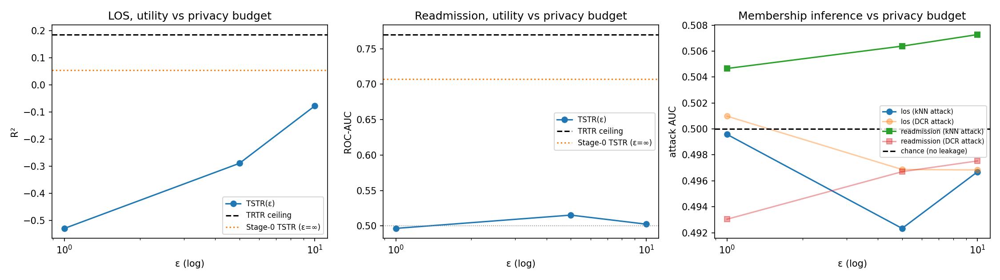

# Differentially-private synthetic EHR with DP-CTGAN: Pillar 1 of a four-pillar programme

*An EngD research study. Belhassen Ouerghi, University of Hertfordshire.*

*Programme: [Stage 0, CTGAN baseline](https://github.com/BelhassenOuerghi/mimic-synthetic-ctgan) · [Stage 1, privacy](https://github.com/BelhassenOuerghi/mimic-synthetic-dp-ctgan) · [Stage 2, fairness](https://github.com/BelhassenOuerghi/mimic-synthetic-fair-dp-ctgan) · [Stage 3, compliance](https://github.com/BelhassenOuerghi/mimic-synthetic-ethic-fair-dp-ctgan) · [Stage 4, realism](https://github.com/BelhassenOuerghi/mimic-synthetic-realism) · [Evidence: five seeds, noise floor](https://github.com/BelhassenOuerghi/mimic-synthetic-evidence)*

## 1. Overview

This repository is Pillar 1, the privacy pillar, of my doctoral programme on
synthetic electronic health records. Stage 0
([`mimic-synthetic-ctgan`](https://github.com/BelhassenOuerghi/mimic-synthetic-ctgan))
established how much predictive utility survives synthesis by a non-private CTGAN,
measured by train-on-synthetic, test-on-real (TSTR) against a train-on-real (TRTR)
ceiling on three MIMIC-IV prediction tasks
([length of stay](https://github.com/BelhassenOuerghi/Length-of-Stay-Prediction-Replica),
[readmission](https://github.com/BelhassenOuerghi/readmission-prediction-replica),
[bed demand](https://github.com/BelhassenOuerghi/bed-demand-prediction-replica)).

This stage asks the question that decides whether synthetic EHR can be released at
all. What does a formal differential-privacy guarantee cost in utility, and does it
actually defeat membership-inference attacks? The same generator is retrained under
differential privacy at a grid of budgets, every budget's synthetic dataset is
pushed through the identical TSTR/TRTR harness, and every release is attacked with
two membership-inference adversaries. The output is the programme's first
privacy-utility frontier.

## 2. Why privacy is the first pillar

Stage-0 synthetic data carries no guarantee of any kind. A GAN can memorise and
regurgitate training rows, and for credentialed clinical data that is a
re-identification incident rather than a modelling footnote. Until the privacy
pillar is applied and evaluated, the synthetic data must be handled exactly like
real MIMIC-IV, which defeats the entire purpose of synthesis.

Privacy therefore comes first after the baseline, for two reasons. It is the
pillar that most constrains utility, so its cost must be measured before bias,
ethics and realism are layered on top. And it is the pillar that converts the
synthetic dataset from a curiosity into a releasable artefact. Differential
privacy is chosen over ad-hoc anonymisation because it is the only definition that
bounds the attacker mathematically, composes across releases, and is recognised by
regulators (in the ICO's anonymisation guidance, and in the EU AI Act's risk
framework) as state of the art.

## 3. The chosen technique: DP-SGD on the CTGAN critic

Stage 0 argued for CTGAN partly because its adversarial critic is the natural
attachment point for privacy. This stage cashes that argument in. I implement
DP-CTGAN: the identical Stage-0 architecture, with the critic trained by DP-SGD
(per-microbatch gradient clipping plus calibrated Gaussian noise, following Abadi
et al., 2016) and the budget tracked by a self-implemented Rényi differential
privacy accountant for the sampled Gaussian mechanism (Mironov et al., 2019).

The full argument is in [`doc/research-paper.md`](doc/research-paper.md); in
outline it rests on five points.

1. Only the critic touches real data. The generator learns exclusively through
   critic gradients, so privatising the critic privatises the generator, and every
   sample it will ever emit, by the post-processing property of differential
   privacy. One mechanism yields a whole-pipeline guarantee.
2. It is a modification rather than a re-platforming. DP-SGD drops into the
   from-scratch Stage-0 training loop, which we own; `src/dp_ctgan.py` subclasses
   `src/ctgan.py`. The architecture, conditional mechanism and evaluation harness
   stay fixed, so the measured utility difference is attributable to the privacy
   mechanism alone, which is the whole point of an incremental ladder.
3. The guarantee is accounted end to end. Every real-data statistic the training
   consumes is costed: the critic steps, by Rényi composition over the sampled
   Gaussian mechanism, and the conditional-sampling category frequencies, released
   once through a Gaussian mechanism. CTGAN's category-matched real batches, which
   would break the subsampling amplification DP-SGD relies on, are replaced by
   uniform sampling with self-derived conditional vectors.
4. PATE-GAN (Jordon et al., 2019) is the main alternative and remains the planned
   comparison arm rather than the platform. PATE partitions the training set among
   teacher discriminators, which suits very large datasets. At our cohort sizes of
   roughly 70,000 to 80,000 rows, each teacher would see a small fraction of an
   already subsampled fit, and the student's guarantee covers a different object
   from the WGAN-GP critic that CTGAN needs. DP-SGD keeps the Stage-0 critic intact
   and is the community-standard baseline against which DP generative work is
   judged.
5. The temporal task receives the same treatment. Bed demand is a single count
   series whose Stage-0 generator is a Poisson-AR model, so its DP counterpart is
   the same model fitted by DP gradient ascent with per-day clipping
   (`src/dp_beddemand.py`). One mechanism family per data modality, each with an
   explicit budget.

DP-SGD is not free. Clipping biases and noise blurs exactly the rare, informative
structure that Stage 0 showed is already the first casualty of synthesis. That is
not a reason to avoid it; it is the trade-off this stage exists to measure.

## 4. Data

Identical to Stage 0: the derived, de-identified feature matrices built by the
three replication repositories from MIMIC-IV v3.1. Raw MIMIC is never touched,
nothing is re-extracted, and no data is committed. Real test sets are withheld
from synthesis entirely, and splits are patient-disjoint.

| Task | Grain | Rows (train / test) | Target |
|---|---|---|---|
| Length of stay | ICU stay | 79,693 / 14,037 | truncated LOS in days (regression) |
| Readmission | ICU stay | 69,699 / 17,342 | 30-day failed discharge (binary) |
| Bed demand | day | 3,289 / 364 | daily ICU-admission count (temporal) |

## 5. Method

* **Generator** (`src/dp_ctgan.py`). The Stage-0 CTGAN with a DP-SGD critic:
  per-PacGAN-group clipping (replace-one sensitivity of twice the clipping norm),
  Gaussian noise, and fixed-size batches accounted at the corresponding sampling
  rate. Conditional category frequencies are released through their own accounted
  Gaussian mechanism, and real rows are self-conditioned. The noise multiplier is
  calibrated by bisection to hit each target budget exactly at the configured step
  count.
* **Accountant** (`src/privacy_accountant.py`). Integer-order Rényi differential
  privacy for the sampled Gaussian mechanism, composed over steps and converted to
  an epsilon-delta pair. Self-contained numpy, MIT licensed.
* **Temporal counterpart** (`src/dp_beddemand.py`). DP full-batch gradient ascent
  on the Stage-0 Poisson-AR likelihood, with per-day sensitivity.
* **Utility** (`src/evaluate_utility.py`). The exact Stage-0 TSTR/TRTR protocol,
  with the same models and the same real test sets, swept over the budget grid, and
  with the Stage-0 non-private result reported alongside as the unbounded-budget
  reference.
* **Privacy evaluation** (`src/membership_inference.py`). Two black-box attacks: a
  distance-to-closest-record attack, and a k-nearest-neighbour-feature logistic
  classifier. Real training rows serve as members and real test rows as
  non-members, and near-duplicate copy statistics are reported alongside. An attack
  AUC of 0.5 means no leakage.

## 6. Results

The authoritative figures come from the five-seed re-run on patient-disjoint
splits, reported in
[`mimic-synthetic-evidence`](https://github.com/BelhassenOuerghi/mimic-synthetic-evidence)
as mean plus or minus a 95% confidence interval. Single-seed numbers across the
full budget grid remain in [`results/`](results/) for provenance.

### 6.1 Utility

| Arm | Readmission ROC-AUC | Length of stay R² | Bed demand MAE |
|---|---|---|---|
| TRTR (real ceiling) | 0.778 ± 0.007 | 0.186 ± 0.001 | 1.475 ± 0.000 |
| Non-private CTGAN (Stage 0) | 0.690 ± 0.018 | 0.009 ± 0.083 | 1.475 ± 0.005 |
| DP-CTGAN at the release budget | 0.519 ± 0.085 | -0.671 ± 1.481 | 1.460 ± 0.005 |

Differential privacy is expensive for the two high-dimensional tabular tasks and
nearly free for the low-dimensional temporal one. The cost of privacy on
readmission is statistically significant (paired t-test across seeds, p = 0.005).
Bed demand is essentially budget-insensitive, even at a very large noise
multiplier, because a two-parameter sufficient-statistic model is intrinsically
robust to gradient noise. That asymmetry is the frontier in one sentence: privacy
is cheap for low-dimensional aggregate structure and expensive for
high-dimensional joint structure.

### 6.2 Privacy

Both attacks sit at chance at every budget, and this includes the non-private
baseline: attack AUC falls in the range 0.497 to 0.505 (±0.006) across all arms and
both tasks, with no near-duplicate synthetic records.

This is the most consequential privacy result in the programme, and it is not the
one I expected. The absence of black-box attack success does not certify the
non-private release as safe. It shows that this class of attack is too weak to
distinguish one budget from another, and therefore that empirical attacks cannot
be used to justify a release. The formal epsilon-delta bound, not the failed
attack, is what carries the argument. Stronger adversaries (white-box,
shadow-model-calibrated, or attribute-inference attacks) remain future work and
could still separate the budgets.

### 6.3 Differential privacy destroys predictability, not merely utility

The multi-seed re-run surfaced a finding that a single run cannot see. Across
seeds, differential privacy inflates the generator's run-to-run standard deviation
substantially.

| Quantity | Non-private (sd) | DP at the release budget (sd) | Inflation |
|---|---|---|---|
| Readmission ROC-AUC | 0.014 | 0.068 | 4.8x |
| Length of stay R² | 0.066 | 1.193 | 17.9x |

Individual DP runs at the same budget produced length-of-stay R² values ranging
from -0.041 to -2.799. Two consequences follow. In practice, an unpredictable
generator is arguably worse than a predictably poor one, because a single run
cannot tell a data controller whether the dataset they are about to release is
usable, and that is precisely the decision they face. Methodologically, the mean
utility cost of privacy on length of stay is not statistically resolvable at five
seeds (p = 0.28), not because the cost is small but because the variance is
enormous. Reporting a single DP training run as the cost of privacy, which is
common practice in the literature and which earlier versions of this paper did, is
therefore unsound.

### 6.4 Corrections

An earlier version of this study used a row-level readmission split, which placed
patients on both sides of the train/test boundary. Roughly 43% of the test set
consisted of patients seen in training. For utility the effect was small, but for
the membership-inference evaluation it was fatal: the non-members were not
non-members. The split is now patient-disjoint, and the attack results in Section
6.2 are measured against a valid control group. The headline privacy finding
survives that correction.

### 6.5 Figure

The privacy-utility frontier: downstream utility against the privacy budget, with the
real-data ceiling and the non-private baseline as reference lines, and the
membership-inference attack results alongside.



## 7. Reproducibility

```bash
PY=python3   # any Python with requirements.txt installed

make smoke    PY=$PY   # single-core wiring check on fabricated data
make generate PY=$PY   # DP-CTGAN per budget, writing synthetic sets outside the repo
make evaluate PY=$PY   # TRTR vs TSTR per budget, plus membership inference
make plots    PY=$PY   # privacy-utility frontier figure
```

Budgets, paths and hyper-parameters live in [`config.yaml`](config.yaml), seeds are
fixed, and the architecture matches Stage 0 exactly. `src/ctgan.py`, `src/data.py`
and `src/beddemand_gen.py` are vendored unchanged from the Stage-0 repository, so
that the difference between the two repositories is exactly the privacy mechanism.
Microbatched DP-SGD costs roughly an order of magnitude more compute per critic
step than Stage-0 training, so a full grid run takes several hours on CPU.

## 8. Threat model and limitations

* **Scope of the guarantee.** The epsilon-delta bound covers the critic's training
  and the conditional-frequency release. Two preprocessing statistics remain
  outside it and are stated as such: the per-column Gaussian-mixture normalisation
  and the discrete category schema, both fitted on real training data. A
  DP quantile-based normalisation is the planned refinement.
* **An accounting approximation.** Fixed-size batches drawn without replacement are
  accounted as Poisson subsampling at the same rate. This is standard practice, but
  it is an approximation, and it is stated rather than hidden.
* **Empirical results are not proofs.** An attack AUC of 0.5 is evidence, not proof.
  The formal statement is the epsilon-delta bound, and the attacks exist to check
  that the bound does real work at practical budgets.
* **Adjacency is row-level.** The unit of protection is one ICU stay, not one
  patient. A patient with several stays has correspondingly weaker protection.
  Patient-level differential privacy, through group privacy or per-patient
  sampling, is outstanding work and is the same conceptual gap as the split defect
  described in Section 6.4.
* **Five seeds is a small sample.** The confidence intervals are honest but wide,
  and a difference reported as within noise may be real but underpowered.

## 9. Data use and ethics

Conducted under the PhysioNet Credentialed Health Data Use Agreement for MIMIC-IV
v3.1. No real patient-level data is committed. The DP synthetic datasets are
written outside the repository; even with a formal budget they remain unreleased
until the full ladder, including the ethics pillar's impact assessment and
residual-risk review, is complete. Only source code, aggregate metrics and
aggregate figures are tracked. These models are research artefacts, not validated
medical devices, and must not inform clinical care.

---

### References

Abadi, M., Chu, A., Goodfellow, I., McMahan, H. B., Mironov, I., Talwar, K., and
Zhang, L. (2016). *Deep Learning with Differential Privacy.* ACM CCS.

Mironov, I., Talwar, K., and Zhang, L. (2019). *Rényi Differential Privacy of the
Sampled Gaussian Mechanism.* arXiv:1908.10530.

Xie, L., Lin, K., Wang, S., Wang, F., and Zhou, J. (2018). *Differentially Private
Generative Adversarial Network.* arXiv:1802.06739.

Jordon, J., Yoon, J., and van der Schaar, M. (2019). *PATE-GAN.* ICLR.

Xu, L., et al. (2019). *Modeling Tabular Data using Conditional GAN.* NeurIPS.

Johnson, A., et al. *MIMIC-IV* v3.1, PhysioNet (2024).
