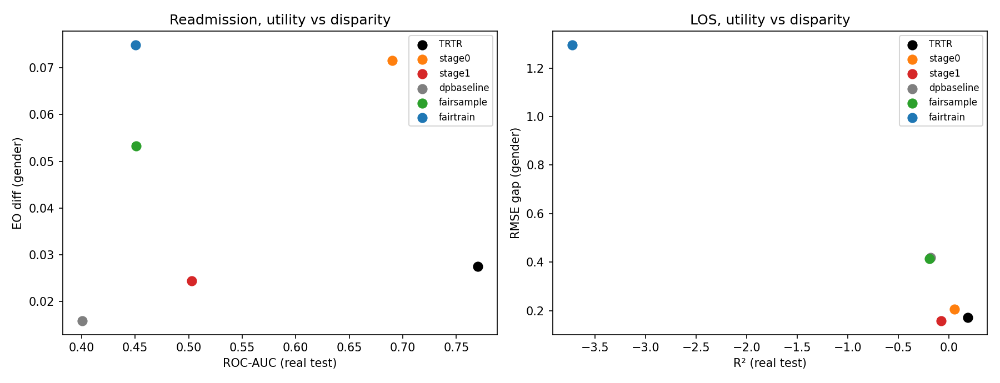
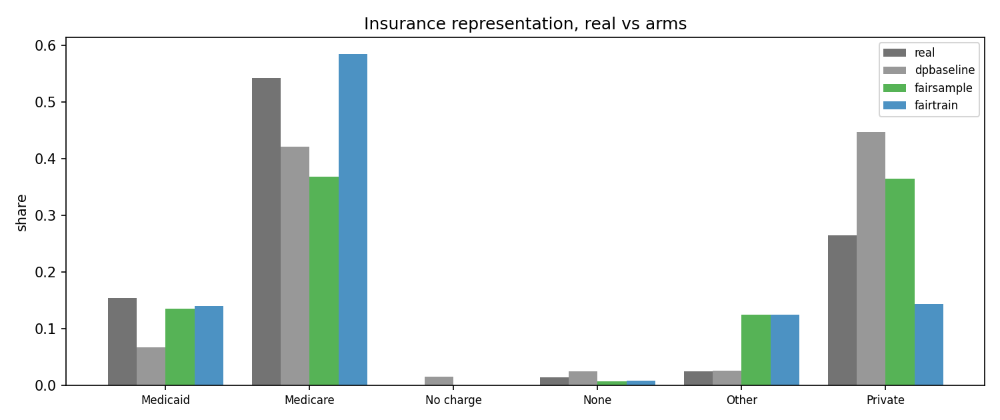

# Fair synthetic EHR under differential privacy: Pillar 2 of a four-pillar programme

*An EngD research study. Belhassen Ouerghi, University of Hertfordshire.*

*Programme: [Stage 0, CTGAN baseline](https://github.com/BelhassenOuerghi/mimic-synthetic-ctgan) · [Stage 1, privacy](https://github.com/BelhassenOuerghi/mimic-synthetic-dp-ctgan) · [Stage 2, fairness](https://github.com/BelhassenOuerghi/mimic-synthetic-fair-dp-ctgan) · [Stage 3, compliance](https://github.com/BelhassenOuerghi/mimic-synthetic-ethic-fair-dp-ctgan) · [Stage 4, realism](https://github.com/BelhassenOuerghi/mimic-synthetic-realism) · [Evidence: five seeds, noise floor](https://github.com/BelhassenOuerghi/mimic-synthetic-evidence)*

## 1. Overview

This repository is Pillar 2, the bias-mitigation pillar, of my doctoral programme
on synthetic electronic health records. Stage 0
([`mimic-synthetic-ctgan`](https://github.com/BelhassenOuerghi/mimic-synthetic-ctgan))
measured the raw utility cost of synthesis. Stage 1
([`mimic-synthetic-dp-ctgan`](https://github.com/BelhassenOuerghi/mimic-synthetic-dp-ctgan))
added a formal differential-privacy guarantee and measured its price. This stage
asks the fairness question that differential privacy itself sharpens: can the
subgroup disparities a synthetic release carries, in representation and in
downstream performance, be reduced at a fixed privacy budget without paying
additional utility?

The generator is retrained at the Stage-1 release budget, two bias-mitigation arms
are layered on, and every arm is scored for utility and for subgroup fairness
against the real-data, non-private and DP-unmitigated references. The dataset
generation is `MIMIC-SyntheticPrivacyBias`.

## 2. Why bias is the second pillar

Two forces push a DP synthetic release toward unfairness.

The first is representation bias. Generative models under-produce minority
subgroups; training-by-sampling mitigates this but does not remove it. A released
population that misrepresents its subgroups misrepresents exactly the patients that
healthcare models already serve worst.

The second is the disparate impact of differential privacy. Gradient clipping and
noise suppress the rare patterns that minority subgroups contribute (Bagdasaryan et
al., 2019), and Stage 1's own results showed the minority readmission class taking
the largest relative hit.

Fairness must therefore be evaluated *at* the privacy budget, rather than before it
or instead of it. That is why this pillar sits directly on top of Pillar 1, and why
these questions were not askable until the budget was fixed. One cannot mitigate a
harm before the mechanism that causes it exists.

The sensitive attributes here are consequential. In the readmission cohort,
Medicare patients are readmitted at 17.1% against 9.1% for privately insured
patients, and the insurance mix is heavily skewed, with Medicare at 55%, Medicaid
at 15.5% and other categories at 2.5%.

## 3. The chosen technique: fair conditional generation

Stage 0 selected CTGAN partly because its conditional mechanism is the natural
fairness hook, and Stage 1 gave the conditional frequencies their own accounted
release. This stage draws on both. There are two arms, differing in where they
intervene (`src/fair_dp_ctgan.py`).

**Fair sampling** (`fairsample`) intervenes at generation time. The trained
generator honours its conditional vector, because the conditional cross-entropy
term forces it to, so the subgroup composition of a released dataset is a free
choice at sampling time. Every draw is conditioned on a sensitive column, with
categories drawn from a target distribution that is uniform over adequately
supported groups; rare groups are floored rather than inflated, since a category
with 0.03% support must not become a fifth of a synthetic population the generator
has never meaningfully modelled. Because the DP-trained generator is
post-processing-safe, this costs no additional privacy budget at all. That is the
central design argument of the stage, and it is a theoretical claim that does not
depend on the data.

**Fair training** (`fairtrain`) intervenes during training. Training-by-sampling
normally draws the conditioned category in proportion to log-frequency, so the
critic sees minority categories rarely. Here the sensitive columns' weights are
replaced by a uniform distribution, which is a data-independent constant and
therefore also free in budget terms, so that minority subgroups are seen as often
as majority ones during fitting. Where fair sampling changes minority count, fair
training targets minority fidelity.

A third arm, `dpbaseline`, is a fresh unmitigated DP run that isolates the
interventions from run-to-run variation.

**Why not the alternatives.** Causally aware fair generators such as DECAF require
a defensible causal graph over 29 to 72 clinical features, which does not exist.
Pre-processing repair, meaning massaging the real data before fitting, breaks the
privacy accounting chain at its root. Post-hoc relabelling of synthetic outcomes
fabricates clinical ground truth. Re-weighting the conditional mechanism that the
platform already has is the only intervention that is simultaneously
architecture-native, free in privacy budget, and attributable within the ladder.
Its limitation is stated up front: with several sensitive attributes the plan
conditions on one column at a time in rotation, so it balances each marginal rather
than the joint distribution. Intersectional balancing is future work.

## 4. Data

Identical real matrices, patient-disjoint splits and test sets as Stages 0 and 1.

| Task | Sensitive attributes | Real shares |
|---|---|---|
| Readmission | gender, insurance | male/female 56/44; Medicare 54, Private 27, Medicaid 15, other 3 (%) |
| Length of stay | gender | male/female 56/44 |
| Bed demand | none (count series) | pass-through, stated as a scope decision |

## 5. Method

The generator, `FairDPCTGAN`, extends the Stage-1 `DPCTGAN`, which is vendored
unchanged along with the accountant and the attack suite. Fair targets are computed
from the same noisy category counts that Stage 1 already releases and accounts for,
so no new real-data statistic is consumed and the guarantee is unchanged.

Six arms per tabular task are scored on the same real test set: `TRTR`, the
non-private Stage-0 release, the DP-unmitigated Stage-1 release, this stage's fresh
`dpbaseline` control, `fairsample` and `fairtrain`.

Fairness metrics (`src/fairness_metrics.py`) are all computed on the real test set:
per-subgroup AUC and RMSE and their maximum-minus-minimum gaps, the
demographic-parity difference, the equalized-odds difference (Hardt et al., 2016),
the mean-signed-error gap, and representation shares against the real population.
Privacy is re-checked rather than assumed: the released arm is re-attacked with the
Stage-1 membership-inference suite, so that the fairness intervention is shown not
to reopen a leakage channel.

One caution was registered before the experiments were run. Stage 1 found
readmission utility near chance at the release budget, and a chance-level classifier
can look fair trivially, because its errors are uniformly distributed. Disparity is
therefore interpreted only jointly with utility, and never on its own.

## 6. Results

The authoritative figures are the five-seed means with 95% confidence intervals from
[`mimic-synthetic-evidence`](https://github.com/BelhassenOuerghi/mimic-synthetic-evidence).
Single-seed numbers remain in [`results/`](results/) for provenance. This section
reports a substantial correction to the first version of this study.

### 6.1 The noise floor, which governs everything else

Re-running the identical DP recipe on the identical split, changing only the
generator's random initialisation, moves readmission ROC-AUC by a mean of 0.095
(maximum 0.157) and length-of-stay R² by a mean of 1.083 (maximum 3.756). The
minimum effect detectable at five seeds is therefore about 0.151 in ROC-AUC and
3.08 in R².

The fairness interventions in this stage produce effects of 0.035 to 0.041 in
ROC-AUC. They are three to four times smaller than the noise against which they must
be measured. Resolving them would require roughly 50 seeds on readmission and
thousands on length of stay. This is not a limitation of the present study; it is a
property of DP generative modelling at this budget, and it means that the standard
practice of reporting single-run DP results is unsound.

### 6.2 A retracted claim

The first version of this study reported that differential privacy collapsed
subgroup representation, driving the Medicare share from 54.1% of the real cohort to
5.9% of the synthetic one, and described this as a systematic harm channel. That
claim is retracted. It was a single seed.

Across five seeds, the Medicare share in the synthetic readmission cohort is as
follows (real cohort: 0.542).

| Arm | seed 42 | 43 | 44 | 45 | 46 | mean ± sd |
|---|---|---|---|---|---|---|
| Non-private CTGAN | 0.443 | 0.435 | 0.593 | 0.598 | 0.552 | 0.524 ± 0.080 |
| DP, unmitigated | 0.421 | 0.095 | 0.285 | 0.613 | 0.618 | 0.406 ± 0.223 |
| Fair sampling | 0.368 | 0.154 | 0.250 | 0.475 | 0.505 | 0.350 ± 0.149 |

Differential privacy ranges from near-total collapse of the Medicare share to
nearly correct representation. The mean does fall, from 0.542 to 0.406, but the
story is not collapse.

### 6.3 What replaces it

The corrected finding is stronger, and it unifies with Stage 1's result.
Differential privacy at practical budgets does not distort representation in a fixed
direction. It makes representation unstable, inflating the run-to-run standard
deviation of the Medicare share by a factor of 2.8, from 0.080 to 0.223. This is the
same phenomenon that Stage 1's utility metrics show, appearing in a second and
independent measurement.

The practical consequence is sharp. A data controller who runs the DP generator once
cannot know whether the cohort they are about to release under-represents its
sickest subgroup by a factor of six or reproduces it faithfully, and auditing that
single run cannot tell them which. An unpredictable harm is worse than a systematic
one, because a systematic one can be corrected.

### 6.4 The interventions, reassessed

Fair sampling does not repair a collapse, because there is no systematic collapse to
repair. It moves the distribution toward its uniform target, which in the original
seed happened to look like repair. What it demonstrably does is stabilise
representation, reducing the standard deviation from 0.223 to 0.149. Its claim to
cost no additional privacy budget is untouched, because that claim is theoretical,
following from post-processing, and never depended on the data.

Its claim to cost no utility, however, is downgraded. The measured effect is far
below the detection threshold of Section 6.1, so the honest statement is that no
utility cost is detectable, not that there is none.

The earlier verdict that fair training is markedly worse is also retracted. It
rested on one dramatic run, in which length-of-stay R² reached -3.72. Across five
seeds the values are -3.72, -0.22, -1.97, -1.17 and -0.01, and the gap to fair
sampling is within noise (p = 0.52). The defensible statement is that at this budget
the DP generator is unstable enough to swamp the difference between training-time
and sampling-time fairness interventions. The instability dominates the
intervention.

### 6.5 Utility and the vacuity caution

| Arm | Readmission ROC-AUC | Length of stay R² |
|---|---|---|
| TRTR (real ceiling) | 0.778 ± 0.007 | 0.186 ± 0.001 |
| Non-private CTGAN | 0.690 ± 0.018 | 0.009 ± 0.083 |
| DP, unmitigated | 0.519 ± 0.085 | -0.671 ± 1.481 |
| Fair sampling | 0.484 ± 0.039 | -0.728 ± 1.701 |
| Fair training | 0.478 ± 0.070 | -1.416 ± 1.875 |

The pre-registered caution was warranted. The fair arms show demographic-parity and
equalized-odds gaps of zero, and inspection shows why: the trained classifier
predicts positive for nobody, so its per-group positive rates are all zero. A useless
model is trivially fair. This is why disparity was pre-committed to joint
interpretation with utility, and it is why the parity table is not the deliverable of
this stage. Whether the fairness mechanism matters clinically now depends entirely on
Pillar 4 restoring utility at a fixed budget.

### 6.6 Privacy re-check

The released arm attacks at chance (attack AUC 0.497 to 0.505, no near-duplicates).
Fair conditioning reweights which regions of the generator's distribution are
sampled, and it does not reopen a memorisation channel.

### 6.7 Figures

The fairness-utility plane. Each arm is a point; disparity is only interpretable jointly
with utility, which is why both axes are shown together.



Subgroup representation by insurance category, real against each synthetic arm. The wide
variation between arms is the instability described in Section 6.3, not a systematic
bias.



## 7. Reproducibility

```bash
PY=python3   # any Python with requirements.txt installed

make smoke    PY=$PY   # single-core wiring check on fabricated data
make generate PY=$PY   # two trainings per task at the release budget
make evaluate PY=$PY   # utility, subgroup fairness and attacks, for six arms
make plots    PY=$PY   # fairness-utility and representation figures
```

Budgets, sensitive columns and support floors live in [`config.yaml`](config.yaml);
architecture and seeds match Stages 0 and 1. The shared source files are vendored
unchanged from the Stage-1 repository, so the difference between the two
repositories is exactly the fairness mechanism.

## 8. Limitations

* **Marginal, not intersectional.** Conditioning rotates through one sensitive
  column at a time and balances each marginal. Joint balancing across gender and
  insurance is future work.
* **Underpowered by construction.** As Section 6.1 shows, the interventions are
  smaller than the noise floor at five seeds. Nothing in this stage about the
  *utility* effect of fairness should be read as established.
* **Fairness of the data is not fairness of a deployment.** Metrics are computed
  through two fixed downstream models; a deployed model with different thresholds or
  features may show different gaps.
* **Utility context.** At this budget the readmission signal is already heavily
  damaged, so the fairness results characterise the mechanism rather than a
  deployable model.

## 9. Data use and ethics

PhysioNet Credentialed Health Data Use Agreement, MIMIC-IV v3.1. No real or synthetic
patient-level data is committed; the synthetic arms are written outside the repository
and remain unreleased pending the compliance pillar. The fairness interventions here
rebalance representation and learning emphasis; they do not alter clinical ground
truth. Research artefacts, not medical devices.

---

### References

Hardt, M., Price, E., and Srebro, N. (2016). *Equality of Opportunity in Supervised
Learning.* NeurIPS.

Bagdasaryan, E., Poursaeed, O., and Shmatikov, V. (2019). *Differential Privacy Has
Disparate Impact on Model Accuracy.* NeurIPS.

van Breugel, B., Kyono, T., Berrevoets, J., and van der Schaar, M. (2021). *DECAF:
Generating Fair Synthetic Data Using Causally-Aware GANs.* NeurIPS.

Xu, L., et al. (2019). *Modeling Tabular Data using Conditional GAN.* NeurIPS.

Abadi, M., et al. (2016). *Deep Learning with Differential Privacy.* ACM CCS.

Johnson, A., et al. *MIMIC-IV* v3.1, PhysioNet (2024).
