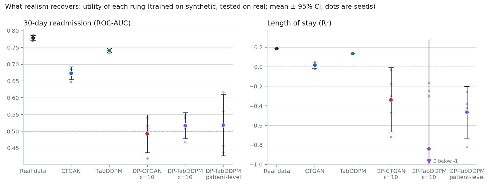
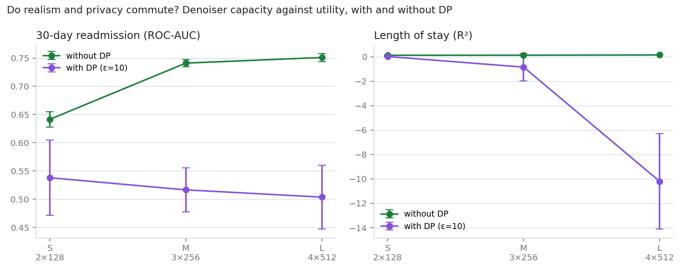
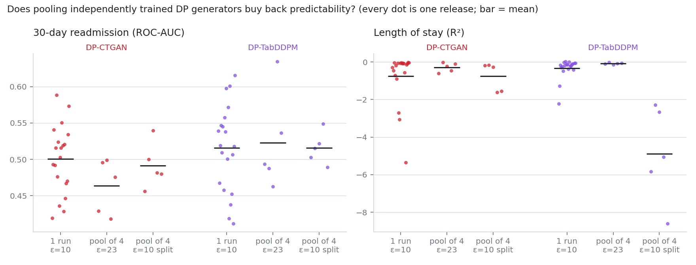

# Realism under privacy: Pillar 4 of a synthetic-EHR programme

*An EngD research study. Belhassen Ouerghi, University of Hertfordshire.*

*Programme: [Stage 0, CTGAN baseline](https://github.com/BelhassenOuerghi/mimic-synthetic-ctgan) · [Stage 1, privacy](https://github.com/BelhassenOuerghi/mimic-synthetic-dp-ctgan) · [Stage 2, fairness](https://github.com/BelhassenOuerghi/mimic-synthetic-fair-dp-ctgan) · [Stage 3, compliance](https://github.com/BelhassenOuerghi/mimic-synthetic-ethic-fair-dp-ctgan) · [Stage 4, realism](https://github.com/BelhassenOuerghi/mimic-synthetic-realism) · [Evidence: five seeds, noise floor](https://github.com/BelhassenOuerghi/mimic-synthetic-evidence)*

## 1. Overview

This repository is the last pillar of my synthetic electronic-health-record
programme. The first three pillars added one safeguard at a time to a synthetic-data
generator (differential privacy, fair sampling, a compliance release gate) and measured
what each one cost. The answer was sobering: privacy and synthesis together destroyed
almost all the predictive value of the data. This pillar asks whether that value can
be recovered **inside** the safeguards, and it tests that question as strictly as I can:
a pre-registered design, five seeds on patient-disjoint splits, independent replicates
to measure the noise floor, and every result reported, including the ones that went
against me.

What I found, in five sentences.

1. **A better generator recovers most of what synthesis destroyed, but only without
   privacy.** A diffusion model I built from scratch (TabDDPM) beats the programme's
   CTGAN on both tasks (readmission ROC-AUC 0.741 against 0.673, length-of-stay R²
   0.135 against 0.017; both survive Holm correction), and its largest variant closes
   74% and 82% of the gap to real data.
2. **It does not survive differential privacy at ε = 10.** Trained privately, it is no
   better than private CTGAN: both sit at chance on readmission, and both make
   length-of-stay predictions worse than predicting the mean. A diagnostic run shows
   the privacy noise, not the trainer or the clipping, is what destroys it.
3. **Realism and privacy do not commute.** The model size that is best without privacy
   is the worst with it, and the smallest is the only private model with a positive
   length-of-stay R² (0.028 ± 0.028, only just). The ladder's ordering, privacy first and realism last, is
   therefore not a convention but a necessity: a generator tuned for realism and then
   made private lands in the wrong place.
4. **Predictability can be bought back, but only with more privacy budget.** Pooling
   four private generators shrinks the run-to-run spread on length of stay tenfold at
   a composed ε of about 23 (five pools are too few for the pre-registered test to
   confirm it); split the same ε = 10 across four runs and, on length of stay, the pool
   is worse than one run.
5. **Moving the privacy guarantee from the ICU stay to the patient costs nothing
   measurable,** which closes a risk the programme had carried since Stage 1.

Along the way the pillar's own checks caught three measurement problems, two of them in
the frozen harness the earlier stages rely on; they are reported in Section 7.5, not
hidden.

## 2. The programme in one table

| Stage | Repository | Question | What it found |
|---|---|---|---|
| 0 | [`mimic-synthetic-ctgan`](https://github.com/BelhassenOuerghi/mimic-synthetic-ctgan) | How much predictive signal survives synthesis? | Less than hoped: readmission ROC-AUC 0.778 → 0.690; length-of-stay R² 0.186 → 0.009 |
| 1 | [`mimic-synthetic-dp-ctgan`](https://github.com/BelhassenOuerghi/mimic-synthetic-dp-ctgan) | What does a formal privacy guarantee cost? | Differential privacy makes the generator unpredictable; attacks sit at chance even without privacy, so only the formal bound can certify a release |
| 2 | [`mimic-synthetic-fair-dp-ctgan`](https://github.com/BelhassenOuerghi/mimic-synthetic-fair-dp-ctgan) | Can subgroup representation be repaired for free? | Fair sampling costs no extra ε; its utility cost is below the noise floor; DP makes representation unstable rather than biased in a fixed direction |
| 3 | [`mimic-synthetic-ethic-fair-dp-ctgan`](https://github.com/BelhassenOuerghi/mimic-synthetic-ethic-fair-dp-ctgan) | Can compliance evidence be generated rather than written? | An evidence compiler and a release gate that can fail; a compliant release can be useless |
| 4 | this repository | Can realism be recovered inside the safeguards? | Yes without privacy (a from-scratch diffusion model closes most of the gap); no at ε = 10; realism and privacy do not commute |
| – | [`mimic-synthetic-evidence`](https://github.com/BelhassenOuerghi/mimic-synthetic-evidence) | Which findings survive seed noise? | A measured noise floor; two claims retracted |

## 3. Why realism is the last pillar

The safeguards of Stages 1 to 3 define what may be released; realism is optimised
inside that region, not before it. Starting from the strongest generator available
would have made this pillar unfalsifiable, because there would have been nothing
to recover. And the evidence repository showed two different problems for realism
to attack. On length of stay, synthesis itself destroyed the signal before privacy
was applied, so the bottleneck is the generator. On readmission, the privacy layer
did most of the damage. A realism intervention that only touched one of the two
could not have fixed both.

## 4. What I built

* **TabDDPM from scratch** ([`src/tabddpm.py`](src/tabddpm.py)): Gaussian diffusion for
  numeric columns, multinomial diffusion for categorical ones, an MLP denoiser with a
  timestep embedding, a cosine schedule and a weight average for sampling
  (Kotelnikov et al., 2023). MIT-licensed, no third-party diffusion code.
* **A private trainer for it**: DP-SGD with true Poisson subsampling, per-example
  gradients (`torch.func`), noise multiplicity, and a switch that makes the privacy
  unit the **patient** rather than the ICU stay. The noise is calibrated in exactly
  Stage 1's convention, so ε = 10 means the same noise level on every rung.
* **Realism metrics** ([`src/fidelity.py`](src/fidelity.py)): detection AUC, precision and
  recall, marginal and dependence errors, against real rows no generator saw, with a
  real-versus-real ceiling; and the true-positive rate at 1% and 0.1% false positives
  for the membership attacks.
* **Pooled releases with exact composition** ([`src/budget.py`](src/budget.py)) and
  **fair resampling** for unconditional generators ([`src/fair_resample.py`](src/fair_resample.py)).
* **Stage 3's release gate, re-applied** to every candidate ([`src/release_check.py`](src/release_check.py)).

## 5. Data

The derived, model-ready feature matrices of the two tabular replication studies
([length of stay](https://github.com/BelhassenOuerghi/Length-of-Stay-Prediction-Replica),
[readmission](https://github.com/BelhassenOuerghi/readmission-prediction-replica)) on MIMIC-IV
v3.1, with the evidence repository's patient-disjoint splits and seeds. Each generator
is fitted on a 30,000-row sample of the training split and releases as many rows as
the training split holds (79,693 for length of stay; about 69,700 for readmission,
varying slightly with the seed). The length-of-stay split is the replication study's
fixed patient-level split, so for that task the seeds vary the fitting sample and the
model randomness only; the readmission split is redrawn, patient-disjoint, per seed. Bed demand needs no realism recovery: its DP generator already forecasts as well as
the real series (evidence repository, MAE 1.460 against 1.475), so it is not re-run here.

## 6. Method

For each task and each of five seeds, 30 arms are scored by the frozen Stage 0-2
harness: the real data itself (the ceiling, and a positive control for the attacks);
CTGAN and DP-CTGAN with Stage 0 and Stage 1's recipes; non-private TabDDPM at three
model sizes; DP-TabDDPM at ε = 10 at the same three sizes, with the patient as the
privacy unit, and with three independent replicates; pools of four private generators
at the per-run and at a split budget; and fair resampling of both private generators.

* **Utility:** train on the synthetic release, test on the untouched real test split.
* **Realism:** detection AUC, precision, recall, density and coverage, marginal and
  dependence errors, against real rows no generator saw.
* **Privacy:** ε in Stage 1's convention and under add/remove adjacency; the frozen
  membership-inference attacks with patient-disjoint members and non-members, including
  the true-positive rate at 1% false positives.
* **Statistics:** paired t-tests across seeds, Holm-adjusted over the family of
  pre-registered primary comparisons; each private recipe's noise floor from its
  independent replicates; Brown-Forsythe tests for spread.

Hyperparameters were chosen once, in a pilot on seed 42's training rows with a
patient-disjoint validation split, by a selection rule committed before the last pilot
results existed. No test set was touched.

The design, the hypotheses and the decision rules were fixed in
[`doc/PREREGISTRATION.md`](doc/PREREGISTRATION.md) before the main run, and the full
method is in [`doc/research-paper.md`](doc/research-paper.md).

## 7. Results

Mean ± 95% CI over five seeds. Full tables, every arm and every metric, are in
[`results/results_table.md`](results/results_table.md); per-seed values are in
[`results/arms/`](results/arms/).

### 7.1 Headline

| Release | ε | Readmission ROC-AUC | Length-of-stay R² | Detection AUC ↓ (readm. / LoS) | Coverage ↑ (readm. / LoS) |
|---|---|---|---|---|---|
| Real training data (ceiling) | – | 0.778 ± 0.007 | 0.186 ± 0.001 | 0.516 / 0.511 | 0.966 / 0.965 |
| CTGAN (Stage 0 recipe) | ∞ | 0.673 ± 0.019 | 0.017 ± 0.032 | 1.000 / 1.000 | 0.075 / 0.605 |
| TabDDPM, 3 × 256 | ∞ | 0.741 ± 0.007 | 0.135 ± 0.005 | 0.950 / 0.639 | 0.456 / 0.940 |
| TabDDPM, 4 × 512 | ∞ | 0.751 ± 0.007 | 0.155 ± 0.000 | 0.767 / 0.599 | 0.896 / 0.961 |
| DP-CTGAN (Stage 1 recipe) | 10 | 0.492 ± 0.056 | −0.339 ± 0.329 | 1.000 / 1.000 | 0.000 / 0.009 |
| DP-TabDDPM, 3 × 256 | 10 | 0.516 ± 0.039 | −0.840 ± 1.113 | 1.000 / 1.000 | 0.000 / 0.001 |
| DP-TabDDPM, 2 × 128 | 10 | 0.538 ± 0.067 | 0.028 ± 0.028 | 1.000 / 0.990 | 0.000 / 0.142 |
| DP-TabDDPM, patient-level | 10 | 0.518 ± 0.092 | −0.466 ± 0.265 | 1.000 / 1.000 | 0.000 / 0.000 |
| Pool of 4 DP-TabDDPM | 23.5 | 0.523 ± 0.084 | −0.080 ± 0.062 | 1.000 / 1.000 | 0.000 / 0.002 |
| Pool of 4 DP-TabDDPM, split budget | 10 | 0.516 ± 0.028 | −4.889 ± 3.193 | 1.000 / 1.000 | 0.000 / 0.000 |

ε is in Stage 1's convention; under add/remove adjacency a single DP-TabDDPM run is
ε = 4.38 and a DP-CTGAN run ε = 3.57. Detection AUC is 0.5 when a classifier cannot
tell synthetic from real rows; coverage is the share of real rows whose neighbourhood
the synthetic data reaches. Every synthetic release sits at chance against both
membership attacks (AUC 0.497 to 0.503; true-positive rate at 1% false positives
0.009 to 0.011, which is chance), while releasing the real data scores 1.000 on both,
so the attacks are capable of detecting a leak.



### 7.2 The pre-registered tests

Fourteen comparisons fixed in advance, paired t-tests across five seeds, Holm-adjusted
across all fourteen. Δ is the first arm minus the second, in ROC-AUC (readmission) or R²
(length of stay). The noise floor is the mean absolute difference between independent
replicates of the private recipe involved; it is defined only for private recipes.

| Hypothesis | Comparison | Readmission Δ (p, Holm p) | Length of stay Δ (p, Holm p) | Verdict |
|---|---|---|---|---|
| H1 | TabDDPM − CTGAN | +0.068 (0.0002, **0.003**) | +0.118 (0.0004, **0.005**) | **supported on both tasks** |
| H2 | DP-TabDDPM − DP-CTGAN | +0.024 (0.43, 1.0) | −0.501 (0.28, 1.0) | not supported: within noise |
| H3b | split-budget pool − single run, TabDDPM | −0.001 (0.96, 1.0) | −4.049 (0.031, 0.31) | pool no better; worse on LoS before correction |
| H3b | split-budget pool − single run, CTGAN | −0.001 (0.96, 1.0) | −0.417 (0.25, 1.0) | pool no better |
| H4 | (L − S) without DP − (L − S) with DP | +0.144 (0.007, 0.078) | +10.250 (0.002, **0.023**) | **supported on LoS**; suggestive on readmission |
| H5 | fair resampling − none, TabDDPM | +0.017 (0.32, 1.0) | +0.469 (0.16, 1.0) | no measurable cost |
| H6 | patient-level − stay-level DP | +0.002 (0.96, 1.0) | +0.374 (0.39, 1.0) | no measurable cost |

Noise floors (mean absolute difference between replicates): readmission 0.049 (DP-CTGAN)
and 0.059 (DP-TabDDPM) ROC-AUC; length of stay 0.942 and 0.712 R². H3a (spread) is a
Brown-Forsythe test, reported in Section 7.4.

### 7.3 Realism and privacy do not commute

| Denoiser | Without DP: readm. / LoS | With DP at ε = 10: readm. / LoS |
|---|---|---|
| S, 2 × 128 | 0.641 / 0.128 | **0.538 / 0.028** |
| M, 3 × 256 | 0.741 / 0.135 | 0.516 / −0.840 |
| L, 4 × 512 | **0.751 / 0.155** | 0.504 / −10.195 |

Without privacy, bigger is better on both tasks. Under privacy the order reverses:
the largest model collapses on length of stay, and the smallest is the best private
model on both tasks. The reversal is decisive on length of stay; on readmission the
private differences are small (S against M: p = 0.40) and the interaction does not
survive Holm correction (Section 7.2), so there it is suggestive rather than shown. DP-SGD adds noise to every parameter, so the noise a model must
average out grows with its size while the signal per step does not. The practical
consequence is the one the programme's ordering was designed around: realism tuned
without privacy has to be re-tuned under it, so privacy must come first.



### 7.4 Predictability, and what ensembling buys

Privacy makes the generator unpredictable for TabDDPM as it did for CTGAN. Across
seeds, length-of-stay R² has a standard deviation of 0.004 without privacy and 0.896
with it; readmission ROC-AUC 0.005 and 0.031. Pooling four private generators at the
per-run budget brings the spread of length-of-stay R² down from 0.525 (twenty single
runs) to 0.050 (five pools) and moves the mean from −0.84 to −0.08, but at a composed
ε of 23.5, and five pools are too few for the Brown-Forsythe test to confirm the
reduction (p = 0.32). Splitting a fixed ε = 10 four ways instead makes each run so
noisy that the pool is worse than a single run on length of stay. Pooling trades
privacy for predictability; it does not create predictability for free.



### 7.5 Fairness needs utility, and utility needs the right label rate

Stage 2 found its fairness metrics vacuous because the classifiers predicted no
positives. Pillar 4 explains why and shows when they become meaningful. The
downstream model weights its classes by the release's own label rate, so a release
with the wrong share of readmissions produces a classifier that predicts one class at
the 0.5 threshold.

| Release | Label rate (real 0.139) | Subgroup cells predicting one class | Demographic-parity gap (real model 0.309) |
|---|---|---|---|
| TabDDPM, 4 × 512 | 0.155 ± 0.011 | 0 of 35 | 0.302 ± 0.030 |
| TabDDPM, 3 × 256 | 0.375 ± 0.104 | 19 of 35 | 0.059 ± 0.072 |
| DP-CTGAN | 0.087 ± 0.012 | 1 of 35 | 0.156 ± 0.066 |
| DP-TabDDPM, 3 × 256 | 0.114 ± 0.138 | 35 of 35 | 0.001 ± 0.002 |

With a release realistic enough to get the label rate right, the fairness metrics
become measurable and track the real-data model closely. Under privacy at ε = 10 the
classifier is degenerate in every subgroup, so the fairness question cannot yet be
asked of a private release. Fair resampling (zero additional ε) cost nothing
measurable on either task.

### 7.6 Three measurement problems, found and fixed

1. **The frozen harness imputes each split with its own median.** On readmission,
   `albumin_min` is 72% missing; in seeds 43 and 46 the training and test medians
   differ (3.2 against 3.1), and the real-versus-real control separated real training
   rows from real test rows with detection AUC 0.956. Realism is now measured against
   the test split imputed with the training medians (control: 0.505 to 0.520 on every
   seed of both tasks). Utility stays on the frozen split, identically for every arm, so it remains
   comparable with Stages 0 to 2. Disclosed in the evidence repository too.
2. **A seed is not a reproducibility guarantee.** Re-running Stage 0 and Stage 1's
   recipes with the same seeds on two threads, instead of twelve, changed the results
   (readmission ROC-AUC by up to 0.043 non-private and 0.061 private), because thread
   count changes floating-point summation order and adversarial training amplifies it.
   The private difference is within DP-CTGAN's measured noise floor (minimum detectable
   effect 0.114); the largest non-private one (0.043, seed 42) is about 2.7 times the
   non-private spread across seeds, so it is not negligible. That is why every
   comparison here uses this repository's own CTGAN runs: all arms share one
   environment.
3. **Precision and recall flatter over-dispersed private samples.** Private releases
   score recall close to 1.0 with precision close to 0, because a very spread-out
   synthetic cloud has huge nearest-neighbour balls. Density and coverage (Naeem et
   al., 2020), which use balls around real rows only, were added after this was seen;
   they put the same releases at coverage 0.000.

### 7.7 The whole ladder in one matrix

Utility, realism, privacy, fairness and compliance for one representative release per
rung, five seeds each. Stage 2's row is from the evidence repository (its realism was
not re-measured here); Stage 3 promotes Stage 2's data unchanged.

| Rung | Release | ε | Readm. AUC | LoS R² | Detection ↓ (readm./LoS) | Attack AUC | Fairness measurable? | Stage 3 gate |
|---|---|---|---|---|---|---|---|---|
| 0 | CTGAN | ∞ | 0.673 | 0.017 | 1.000 / 1.000 | 0.50 | yes (0 of 35 cells degenerate) | refused: no formal bound |
| 1 | DP-CTGAN | 10 | 0.492 | −0.339 | 1.000 / 1.000 | 0.50 | partly (1 of 35) | promoted |
| 2 | DP-CTGAN, fair sampling | 10 | 0.484 | −0.728 | – | 0.50 | vacuous (Stage 2) | promoted |
| 3 | Stage 2's data, gated | 10 | 0.484 | −0.728 | – | 0.50 | vacuous | promoted; external release on HOLD |
| 4 | TabDDPM, 4 × 512 | ∞ | 0.751 | 0.155 | 0.767 / 0.599 | 0.50 | yes, tracks the real model | refused: no formal bound |
| 4 | DP-TabDDPM, 2 × 128 | 10 | 0.538 | 0.028 | 1.000 / 0.990 | 0.50 | no (35 of 35) | promoted |
| 4 | DP-TabDDPM, patient-level | 10 | 0.518 | −0.466 | 1.000 / 1.000 | 0.50 | no (35 of 35) | promoted |

Read down the columns and the programme's argument is visible. Every release passes
the gate's empirical check, so the gate's decision rests entirely on ε. The releases it
promotes are the ones with no realism and little utility, and the realistic ones are
refused. The gate is doing its job; the matrix shows what its job cannot see.
([`results/release_check.md`](results/release_check.md) has every arm.)

Two implementation faults were caught by unit tests before any experiment ran: the
weight average used for sampling needed a warm-up, and Apple's GPU backend needed
fixed tensor shapes to avoid recompiling every step. Both are described in the paper.

## 8. Reproducibility

```bash
PY=python3   # any Python with requirements.txt installed

make test             # unit tests on fabricated data, no MIMIC needed
make verify-vendored  # the frozen Stage 0-2 harness is byte-identical
make pilot            # the one hyperparameter search (seed 42 training rows only)
make run              # every arm and seed; resumable, one subprocess per arm
make realism          # realism vs a train-median-imputed test split; label rates
make aggregate        # intervals and the pre-registered tests -> results/
make plots            # figures -> results/plots/
```

Paths in [`config.yaml`](config.yaml) are relative to this repository; set
`SYNTHEHR_REPOS_ROOT` and `SYNTHEHR_SYNTH_ROOT` to point elsewhere. Synthetic datasets are
written outside the repository. Per-arm, per-seed results are committed under
`results/arms/` so every number in this README can be traced to a file.

## 9. Limitations

* **One budget.** Everything private here is at ε = 10 in Stage 1's convention (about
  4.4 under add/remove adjacency). A larger budget, or a generator designed for privacy
  from the start, such as the marginal-based methods that lead differential-privacy
  synthesis benchmarks, may behave differently. This pillar tests whether the
  programme's chosen route recovers realism; it does not rank every route.
* **Five seeds.** Several effects are large but not resolved at n = 5, most notably the
  tenfold reduction in spread from pooling. A null is reported as unresolved, never as
  absent.
* **Tuning on private data.** The pilot chose hyperparameters on seed 42's training
  rows. That is standard practice, but it is a leak the ε does not cover (Papernot &
  Steinke, 2022), and the model sizes were not part of the pilot.
* **Non-privatised preprocessing.** The quantile transform and the category lists are
  fitted on real training rows, as DP-CTGAN's normalisation is.
* **One dataset.** MIMIC-IV only. Generalisation is the job of a second-dataset
  validation (eICU-CRD), not done here.
* **Thresholded metrics depend on the label rate.** Accuracy and the parity-based
  fairness metrics are reported at the 0.5 threshold, as in Stages 0 to 2; Section 7.5
  shows how much that choice matters.

## 10. Data use and ethics

PhysioNet Credentialed Health Data Use Agreement, MIMIC-IV v3.1. No real or synthetic
patient-level data is committed; only aggregate metrics are. Synthetic data derived
from MIMIC is treated as derived data under the agreement and is not redistributed.
Research artefacts, not medical devices.

### References

See [`doc/research-paper.md`](doc/research-paper.md#references).
